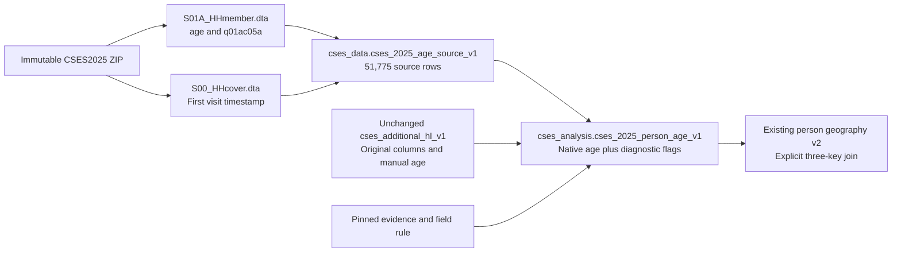

# CSES 2025 age selection and analysis interface

The 2025 roster contains an age for all 51,775 members, but the original database projection
selected only `q01ac05a`, which has 165 answers. The new interface selects the native `age`
field without changing the original projection. It preserves both values and separates age
availability from verification of the underlying calculation.

Published on 2026-10-18 as alignment release **17**. The committed database interfaces retain
the suffix `v1` because this is their first publication; the corrected release driver and
evidence use source-v2.

## Variable brief

| Item | Verified scope |
| --- | --- |
| Members | 51,775 member-wave records in 12,338 households; not necessarily direct respondents |
| Selected variable | `S01A_HHmember.dta:age`, labeled `Calculated age` |
| Native values | 51,775 non-null integers, observed range 0–105 |
| Original manual field | `q01ac05a`, retained as `age_source_value` in the interface and unchanged in the original table |
| Manual overlap | All 165 manual answers agree with native `age` |
| Age 6–17 | 11,753 members using native `age`; unweighted sample count |
| Calculation limits | Formula, reference date and upper-age coding are not independently verified |
| Other waves | Outside this interface; no new cross-wave age-equivalence claim |

The archived English household form, sheet `01 A_ Initial (2)`, asks for date of birth at Z5
and completed years at AF5, with zero for infants at AF9. The form also includes an older
roster sheet. Neither the cached form text nor the supplied electronic export specifies the
native calculation formula. Unknown birth components are coded `-98` in the export; they
must not be interpreted as literal dates.

The wave key remains `2025`. Household first-visit timestamps span June 2025 to June 2026;
the wave label is not a filter limiting interviews to calendar year 2025.

## First visit date diagnostic

For a separate diagnostic, completed years are calculated from valid birth components and
the household's first-visit timestamp. This does not establish that the native calculation
uses that date.

| Diagnostic status | Members | Interpretation |
| --- | ---: | --- |
| `matches_first_visit_calendar_age` | 51,096 | Native age agrees with this diagnostic |
| `differs_from_first_visit_calendar_age` | 4 | Native age is one year higher |
| `incomplete_or_invalid_birth_date` | 675 | No calendar-age comparison is available |

The four differences are retained, not automatically classified as incorrect ages. The 675
incomplete dates do not mean age itself is missing. Even agreement with this diagnostic does
not certify the electronic formula. No age was imputed or overwritten.

## Database interface

Use `cses_analysis.cses_2025_person_age_v1` explicitly. It contains every original 2025 HL
column plus `age_for_analysis`, the native-variable name, provenance hashes, verification flags,
and the first-visit diagnostic. All 51,775 records remain linked by
`(survey_wave, household_key, record_key)`; UUID-based keys must not be converted to numbers.

`age_for_analysis` is a selection of a supplied source value, not a newly certified exact-age
measure. `age_formula_verified`, `age_reference_date_verified` and
`age_topcode_semantics_verified` remain false. The original `age_source_value` stays sparse
by design; consumers querying the older table or geography views must explicitly join or
switch to this interface to use the new selection.

```sql
SELECT first_visit_check_status, count(*) AS members,
       count(age_for_analysis) AS native_ages,
       count(age_source_value) AS manual_ages
FROM cses_analysis.cses_2025_person_age_v1
GROUP BY first_visit_check_status;

SELECT a.record_key, a.age_for_analysis, a.first_visit_check_status,
       g.admin1_code, g.admin2_code, g.admin3_code, g.admin4_code
FROM cses_analysis.cses_2025_person_age_v1 a
JOIN cses_analysis.cses_person_geography_v2 g
  USING (survey_wave, household_key, record_key);
```

The map join preserves source administrative codes. It does not resolve historical village
identity or missing village geometries. School attendance still needs its own eligibility
and routing rules; selecting age does not recode skipped school answers as No.

## Source lineage and release evidence



This overview supplements, rather than overwrites, the historical machine-readable lineage
graph. The database stores the new source bridge, a one-row field rule at
`cses_alignment.cses_2025_age_rule_v1`, and additive release/storage/dataset-output/load records.
The existing dataset and source-variable catalog registrations are reused.

Release artifacts are under `data/releases/cses-2025-age-source-v2/`: source Parquet,
questionnaire locators and source hashes in `evidence.json`, the execution plan, rollback
rehearsal, publication receipt, postflight and independent acceptance checks. Original datasets,
the five-wave release and its pilot evidence remain unchanged. The backup is
`data/backups/cses_2025_age_v2/before_2025_age.dump`.

The earlier source-v1 diagnostic was rolled back and never published. It allowed the date
parser to normalize some unknown `-98` components into real dates. Source-v2 rejects unknown,
noninteger and normalized dates before comparison, with independent Python-date verification.
Both the frozen transactional engine and the versioned driver are pinned through an
implementation manifest; historical source-v1 artifacts remain available for audit only.

The publication workflow is `rsc/cses_db/publish_cses_2025_age_v2.py` with separate `build`,
`prepare`, `rehearse`, `publish` and `validate` actions. Preparation takes a fresh full backup
of the four CSES schemas and verifies archive decompression. Rehearsal executes and rolls back
the transaction, then checks that targets are absent and previous data remains unchanged.
Identity sequences can advance during rehearsal; such gaps are not missing survey records.
After a confirmed publication, use only the read-only acceptance actions:

```bash
.venv/bin/python rsc/cses_db/publish_cses_2025_age_v2.py validate
.venv/bin/python rsc/cses_db/validate_cses_2025_age.py
```

Both postflight checks use a read-only transaction and the `mda_readonly` analytical role.
The independent acceptance check compares every selected age to the immutable Stata member,
checks the manual field and geography join, and verifies that unconfirmed semantics remain
flagged. Publication also protects all previous CSES physical rows, existing view definitions,
columns and privileges; only additive registry rows and the three new relations are permitted.

Regression verification: 528 repository tests pass, including 11 focused age/date cases.
The missing-date regression explicitly covers `-98` day/month values, zero components,
fractional days and invalid leap dates.

Release 17 passed both postflight checks as `mda_readonly`: all 51,775 selected ages match
the original Stata source, all date diagnostics pass the independent calculation, and all
51,775 records join the existing geography interface. The 52 pre-existing physical relations
retain their previous rows; definitions, columns and privileges of 104 existing relations
are unchanged. See `validated.json` and `independent-checks.json` in the source-v2 release.
