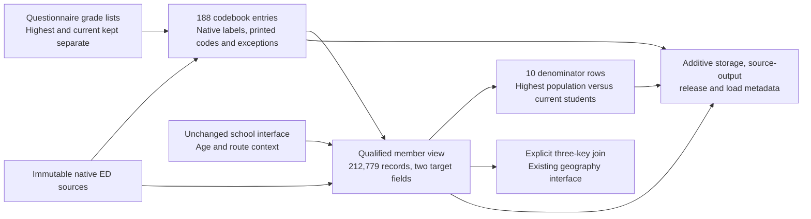

# CSES additional wave attainment and current study levels

Published 2026-10-18 as alignment release 21.

Highest educational attainment and current study describe different things. This interface
keeps both source codes, interprets their wave-specific dictionaries separately, and exposes
qualified semantic families and ordinary school-grade numbers. It covers the same 212,779
member-wave records as the five-wave school interface; no people or survey waves are added.

The dictionary has 188 entries across nine available field-wave pairs: highest attainment in
five waves and current level in four. These are code meanings, not 188 newly aligned variables.
No ISCED crosswalk, ordered all-education score, common degree equivalence or completed-years
measure is certified.

## Variable brief and denominators

| Wave | Highest applicable members | Qualified highest family | Unresolved highest | Ordinary completed-grade values | Highest derived from never-attended skip |
| --- | ---: | ---: | ---: | ---: | ---: |
| 1996 | 40,968 | 40,797 | 171 | 25,324 | 0 |
| 1997 | 26,671 | 26,382 | 289 | 16,484 | 8,273 |
| 1999 | 29,002 | 29,002 | 0 | 18,808 | 8,255 |
| 2023 | 49,475 | 49,472 | 3 | 35,285 | 7,314 |
| 2025 | 49,455 | 49,454 | 1 | 34,024 | 6,674 |
| Field-record totals | 195,571 | 195,107 | 464 | 129,925 | 30,516 |

The highest-family count includes explicit categories such as None unspecified, no grade
completed, Other and degrees with unspecified subtype. It is not a count of precisely
equivalent qualifications. The 30,516 skip-derived never-attended categories are separate
from observed source answers and do not create numeric zero grades or years.

| Wave | Current-level source available | Reported current students within age range | Qualified current family | Unresolved current level | Ordinary current-grade values |
| --- | --- | ---: | ---: | ---: | ---: |
| 1996 | No | Not defined for this field | 0 | Not defined | 0 |
| 1997 | Yes | 7,007 | 6,986 | 21 | 6,895 |
| 1999 | Yes | 8,049 | 8,049 | 0 | 7,859 |
| 2023 | Yes | 12,303 | 12,303 | 0 | 10,806 |
| 2025 | Yes | 12,620 | 12,620 | 0 | 10,720 |
| Field-record totals | Four waves | 39,979 | 39,958 | 21 | 36,280 |

Current-level applicability requires a reported current-attendance Yes, an education record,
and the questionnaire age threshold. Conflicting Yes answers remain in that potential
denominator but do not receive a qualified level. A recorded grade without current-attendance
Yes is retained as a diagnostic, not used to infer attendance.

1996 asks current attendance in its general education block but has no current-grade field
in that selected source. Its child-work block also asks attendance, not a current grade.
This is field unavailability, not evidence that its questionnaire file is missing. All
46,811 members remain in the interface with an explicit unavailable-current-level status.

These are unweighted member-wave counts, not direct respondents or unique people followed
across years. Highest and current counts overlap within people and must not be added into
a respondent total. The [school interface](cses-additional-school-attendance.md) supplies age
and route context; 2025 retains the [native-age qualifications](cses-2025-age-interface.md).

## Meaning differences that remain visible

| Source situation | Preserved interpretation |
| --- | --- |
| 1996 highest code 12 | Secondary school certificate or diploma, not ordinary Class 12 |
| 1997 and 1999 code 13 | Secondary certificate, without forcing lower versus upper subtype |
| 1996 vocational BST/OS codes 13 and 14 | Separate undergraduate and graduate source families; not forced into later pre/post-secondary vocational categories |
| 1997 code 0 | None unspecified; does not independently establish never attended or zero completed years |
| 1999 code 0 versus 99 | Preschool/kindergarten versus None; 99 is not an unknown-response code |
| 1996 highest 99; 2023 highest 98; 2025 highest -98 | Explicit missing/unknown meanings, not None attainment |
| Modern highest 9 and 12 | Ordinary grades whose native labels specify without certificate; certificate differences remain in the native labels |
| Modern highest 18 versus current 18 | Bachelor in completed-attainment question versus Masters in current-study question |
| Modern highest 20 versus current 19 | Doctorate in the two different dictionaries; current study is not a degree already held |
| Older postgraduate or graduate labels | Retained as unspecified degree/study subtypes, not automatically Bachelor, Masters or Doctorate |
| 2025 native Other code 96 | Printed Other is highest 21 and current 20; native code and source-form difference are retained |

Only literal ordinary grades receive numeric grade values: 1–11 for 1996 highest, 1–12 in
the other available dictionaries. Preschool, no grade completed, certificates, vocational
training and university categories do not become grade numbers. The two grade columns refer
respectively to completion and current enrolment; neither is completed years attended.

2025 has 31 highest and seven current Other observations using native 96. Their category is
supported by the native Other label and corresponding printed meaning, with a code-difference
flag. This is not certification of the electronic questionnaire's numbering or enablement.
The unused native -98 unknown entry is also retained in the dictionary alongside printed 98.

Some 1997 ordinary-grade values lack individual native Stata labels because the dictionary
uses an abbreviated sequence. The printed Class 1, Class 2, through Class 12 sequence supports
the expanded grade meanings. Native labels remain NULL where absent; the dictionary records
`questionnaire_grade_sequence_expansion_native_label_absent` rather than inventing a native label.

## Field specific qualification

The interface first preserves the raw highest/current codes, source labels and codebook
families for inspection. The separate qualified columns apply age, availability, native-code
and field-specific route checks. Unknown codes and explicit unknown responses remain distinct.

For highest attainment, a documented ever-attended=No skip can yield the marked category
`never_attended` only when no conflicting history, current grade or current-attendance Yes
is present. A valid highest response is not automatically discarded because another education
item is missing or invalid. Such other-item warnings are retained. Missing ever-attendance
with a valid highest answer is also separately marked; an explicitly invalid gate code is
not silently treated as a missing gate.

For current level, a valid current-attendance Yes is required. A None response is not a current
school level, although it can be meaningful as a highest-attainment response. Current-attendance
No with a recorded current grade is flagged as an out-of-route response. No grade is imputed
from highest attainment, age, school attendance, or the previous/next grade.

The 464 highest exceptions comprise 171 explicit 1996 unknowns, 289 unresolved 1997 records,
two explicit 2023 unknowns plus one invalid ever-attended gate, and one 2025 missing response
with unresolved gate. The 1997 highest exceptions are 162 missing with unresolved gate,
96 never-attended route conflicts, 29 missing after ever-attended=Yes, and two invalid gate codes.
Separately, 17 valid highest responses with missing gates and 39 with other-item warnings
remain usable and visibly qualified.

All 21 unresolved current levels among reported current students are in 1997: 11 missing
grades, six None responses, and four never-attended/current-attendance conflicts. The recorded
values outside the current-attendance route remain visible; they are not additional current
students. These exception sets can overlap with highest exceptions and must not be summed
into unique people.

## 1999 attendance rule erratum

The historical school-attendance v1 rule listed code 0 as neutral for both 1997 and 1999.
That is correct only for 1997. The 1999 form and Stata dictionary identify 0 as preschool
and 99 as None. Rechecking every 1999 member with the correct meanings changes **zero**
existing attendance conflict classifications: the relevant never-attended/skipped rows do
not contain those conflicting level responses. Its existing attendance values and counts
therefore remain unchanged.

The new level dictionary uses the correct 1999 meanings. The frozen historical school rule
is not rewritten; do not reuse its incorrect neutral-code metadata for future ingests.
Its warning field remains historical context, not the authority for the new level meanings.
New level qualification independently uses the target-specific codebook. The audit and
zero affected-record count are recorded in this release's evidence.

## Database interface and source evidence

The three new relations are:

- `cses_alignment.cses_additional_education_level_codebook_v1`: 188 source-code entries,
  keyed by wave, highest/current target and native code; labels, printed code, source hash,
  locator and qualification remain available.
- `cses_analysis.cses_additional_education_levels_v1`: 212,779 members and 40 columns,
  including separate source and qualified families, two grade numbers, two statuses and
  applicability flags.
- `cses_analysis.cses_additional_education_level_coverage_v1`: ten wave/field rows with
  source availability, potential applicability, qualified records and unresolved counts.

```sql
SELECT survey_wave, target, target_available, target_applicable_members,
       qualified_family_records, qualified_general_grade_records,
       unresolved_applicable_records, derived_never_attended
FROM cses_analysis.cses_additional_education_level_coverage_v1
ORDER BY survey_wave, target;

SELECT survey_wave, target, source_code, native_value_label, semantic_family,
       questionnaire_code, source_form_code_differs, qualification
FROM cses_alignment.cses_additional_education_level_codebook_v1
WHERE source_code IN (0, 12, 18, 96, 99, -98)
ORDER BY survey_wave, target, source_code;
```

Sources are the unchanged raw ED members identified in
[the five-wave specification](../rsc/specs/cses_additional_waves_v1.json). The codebook preserves
their native value labels, and every selected level value is checked against archived Stata.
Questionnaire locators are retained from the [source review](cses-additional-school-attendance.md#questionnaire-evidence):
1996 printed page 6; 1997 PDF page 4; 1999 II Schooling Q2 and its grade-code list; 2023 English
PDF page 12; and 2025 `02 Education (2)` X10/X12 for highest and AL10/AL12 for current.
The 1997 and 2023 PDF pages were visually inspected; legacy Word and 2025 workbook evidence
use the existing literal text/cell caches, not a new layout or electronic-routing certification.



Join geography on `(survey_wave, household_key, record_key)`. Native composite keys do not
establish longitudinal identities, and source village codes do not certify historical village
geometry. No source tables, existing views or historical lineage files are replaced.

## Release workflow and verification

The local builder is `align_cses_additional_levels.py`; the publication workflow is
`publish_cses_additional_levels.py` with separate `check`, `prepare`, `rehearse`, `publish`
and `validate` actions. Preparation performs read-only exact-cell SQL comparison, snapshots
previous data/interfaces, takes a fresh backup of the four CSES schemas and verifies full
backup decompression. Rehearsal rolls back the dictionary, views and metadata before checking
that the targets are absent and previous rows remain unchanged.

Artifacts are under `data/releases/cses-additional-education-levels-v1/`; the backup is
`data/backups/cses_additional_levels_v1/before_education_levels.dump`. After publication,
do not rerun creation actions against existing targets. Read-only checks are:

```bash
.venv/bin/python rsc/cses_db/publish_cses_additional_levels.py validate
.venv/bin/python rsc/cses_db/validate_cses_additional_levels.py
```

The independent acceptance reads original Stata sources and verifies native keys, level codes,
age/route context, the two qualified classifications and all ten denominators with separate
scalar logic. Before publication the same source check runs locally with `--local`. Current
study and completed attainment have separate logic, including None/unknown and missing-route
cases. The new interface does not alter the historical ten-wave education grouping or the
five-wave school-attendance outputs.

### Confirmed release acceptance

Release 21 committed successfully on 2026-10-18. Both post-publication checks passed using
`mda_readonly` in read-only transactions. Exact-cell SQL acceptance matched all 212,779 member
records and all 188 codebook entries; the separate native-source validator verified 425,558
field classifications with zero native/qualified mismatches, all ten denominator rows, and
212,779 joins to the existing geography interface. These joins preserve source geography
linkage; they do not certify historical map boundaries.

The publication added three outputs and 25 source-output edges. Protected historical rows
and interfaces remained unchanged after rollback rehearsal and final publication. The full
repository suite passed 561 tests, including 18 focused education-level tests and an exhaustive
3,600-case scalar/vector classification comparison. Lint and whitespace checks also passed.

Immutable receipts are `published.json`, `validated.json` and `independent-checks.json` in the
release artifact directory. The 464 unresolved highest and 21 unresolved current field records
remain explicitly flagged; acceptance does not imply that these answers or all cross-wave
qualification differences have been resolved.
