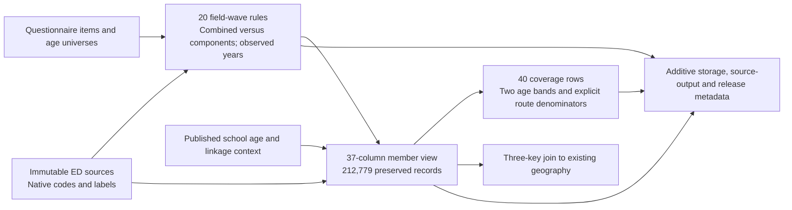

# CSES additional wave literacy and observed school years

Published 2026-10-18 as alignment release 24, using publisher revision 2.

The five-wave literacy and school-years interface preserves all 212,779 member-wave records
for 1996, 1997, 1999, 2023 and 2025. It separates combined literacy from independent reading
and writing questions, and observed completed years attended from highest or current grade.
The additive release keeps source answers and existing database interfaces unchanged.

## Variable brief and denominators

| Wave | Questionnaire age range | Qualified combined literacy / eligible | Independent reading | Independent writing | Qualified observed school years / ever-attended Yes |
| --- | --- | ---: | ---: | ---: | ---: |
| 1996 | 5+ | 40,968 / 40,968 | Not collected separately | Not collected separately | Not collected |
| 1997 | 5+ | 26,669 / 26,671 | Not collected separately | Not collected separately | Not collected |
| 1999 | 5+ | 29,002 / 29,002 | Not collected separately | Not collected separately | Not collected |
| 2023 | 3+ | 49,475 / 49,475 | 49,475 / 49,475 | 49,475 / 49,475 | 42,159 / 42,160 |
| 2025 | 3+ | 49,425 / 49,455 | 49,454 / 49,455 | 49,425 / 49,455 | 42,780 / 42,780 |

Combined literacy has 195,539 qualified records and 32 unresolved eligible records. Of the
qualified records, 96,639 are observed legacy combined answers and 98,900 are derived from
two valid modern answers. These are different instruments, not 195,539 identically asked
responses. Separate reading has 98,929 qualified records, separate writing 98,900, and
observed school years 84,939; these field counts overlap within people and must not be added
into a respondent count. All counts are unweighted member-wave records, including proxy
reports, not unique people followed across waves or counts of direct respondents.

Coverage also supplies a common ages-15-plus band. It gives descriptive comparisons a common
minimum age instead of mixing questionnaire universes; it does not standardize age distributions.
The older three
waves do not supply separate reading, separate writing or a completed-years field in the
selected education sources; field unavailability is not an unanswered question.

| Wave | Ages 15+ members | Qualified combined literacy | Unresolved combined literacy |
| --- | ---: | ---: | ---: |
| 1996 | 26,746 | 26,746 | 0 |
| 1997 | 18,191 | 18,191 | 0 |
| 1999 | 19,817 | 19,817 | 0 |
| 2023 | 37,156 | 37,156 | 0 |
| 2025 | 37,422 | 37,414 | 8 |

## Literacy meaning and exceptions

The older question asks whether the member can read and write a simple message in any
language; 1996 also mentions dialect. It is a single Yes/No answer. A No does not identify
which skill is absent, and this interface never splits the combined item into components.

2023 and 2025 ask reading and writing separately. Each preserves native 1=Yes, 2=No, with
qualified values 1 and 0. The derived combined indicator is 1 only when both valid responses
are Yes, and 0 when both responses are valid and at least one is No. If either component is
missing or unrecognized, the combined result remains null, even if the other answer is No.
`combined_derived_from_components` distinguishes this conjunction from an observed legacy
answer. Instrument equivalence is not certified, nor is a language-specific proficiency test.

The two unresolved legacy combined answers are in 1997. In 2025, 29 writing values are native
0, outside the attached Yes/No dictionary. They remain 0 in the source column but null in the
qualified writing and combined columns. Twenty-eight report reading No and one reading Yes;
neither pattern establishes that writing 0 means No. One additional eligible 2025 member has
both components missing. Among ages 15+, seven undefined writing codes and that one missing
pair remain unresolved.

Literacy is asked before the ever-attended gate. A never-attended, invalid-gate or missing-gate
answer therefore does not itself invalidate an otherwise valid literacy response. Age and
education-record availability still apply. `write_yes_read_no_warning` exposes the possible
component pattern without rewriting either answer.

## Observed completed years and route checks

Only 2023 and 2025 provide the selected completed-years item. Its printed instruction says
to enter the completed number of years attended. It is not the highest grade code, current
grade, a credential ladder or an imputed standard duration. An observed zero after
ever-attended Yes is retained: it can represent attendance without a completed year.

Qualification requires an eligible member, a linked education record, native ever-attended
Yes, an integer from 0 through 30, and years not greater than the source age selected by the
[school interface](cses-additional-school-attendance.md). The 0-30 interval is an explicit
analytical screening rule shared with the older education workflow, not a questionnaire
maximum. No observed value in these two waves fails this numeric interval. The published
[2025 age limitations](cses-2025-age-interface.md) continue to apply.

The 2023 source has 42,161 non-null years values. One belongs to an undefined ever-attended
code 3 and is excluded. Another reports five years attended at source age four and is excluded
as an age conflict. Original age, gate and year values remain unchanged. Among the 42,160
reported ever-attended Yes records, 42,159 qualify and one is unresolved by the age check.
In 2025 all 42,780 reported ever-attended Yes records have qualified observed years.

There are 7,314 documented never-attended skips in 2023 and 6,674 in 2025. Their blank years
remain null with `documented_skip_no_years_value`; no zero is imputed. The additional eligible
2025 member with a missing ever-attended gate has unresolved years and is not part of the
ever-attended-Yes denominator. The coverage view therefore distinguishes age eligibility,
expected responses by route, unresolved expected responses, invalid gates and structural skips.
An average of `years_qualified` describes qualified ever-attenders, not all eligible members;
do not silently treat null skips as either observed zero or random nonresponse.

Years/age checks do not verify a native age formula or establish minimum school entry age.
The interface does not force years to equal completed grade and does not silently repair a
discrepancy by changing either source answer.

## Database use and provenance

The additive outputs are:

- `cses_alignment.cses_additional_literacy_years_rule_v1`: 20 field-wave rules, including
  unavailable fields and marked modern conjunctions; source variable names/labels, native
  dictionaries, form hashes and locators remain attached.
- `cses_analysis.cses_additional_literacy_years_v1`: 212,779 member rows and 37 columns,
  preserving four native source values separately from four qualified values, statuses,
  applicability, age/gate context and derivation/diagnostic flags.
- `cses_analysis.cses_additional_literacy_years_coverage_v1`: 40 rows, covering four targets
  in five waves and two age bands with explicit field availability and route denominators.

`source_available` means the inputs for that target are present in the selected source.
For modern combined literacy it refers to the two components, not an independently asked
combined question. `combined_source_value` is null in both modern waves; inspect the rule's
`mode` and `source_variables` rather than interpreting that null as a failed response.

```sql
SELECT survey_wave, target, source_available, target_applicable_members,
       expected_response_by_route, qualified_records, unresolved_expected_response,
       derived_combined, documented_years_skips, years_age_conflicts
FROM cses_analysis.cses_additional_literacy_years_coverage_v1
WHERE age_band = 'questionnaire_age_eligible'
ORDER BY survey_wave, target;

SELECT survey_wave, qualified_yes, qualified_no, qualified_records,
       target_applicable_members, unresolved_expected_response, derived_combined
FROM cses_analysis.cses_additional_literacy_years_coverage_v1
WHERE age_band = 'ages_15_plus' AND target = 'combined'
ORDER BY survey_wave;
```

Sources and binary labels are independently checked against the archived native Stata
members in the [five-wave specification](../rsc/specs/cses_additional_waves_v1.json).
Questionnaire evidence is 1996 printed page 6 column 28 in its literal Word cache, 1997 PDF
page 4, 1999 II SCHOOLING Q2 column 3 in its literal Word cache, 2023 English PDF page 12,
and 2025 `02 Education (2)` cells B3, L10/L16, O10/O16, R10/R16 and U10/U17/U26. The two PDF
pages were visually inspected. The 2025 locators refer to cached literal workbook cells,
not electronic questionnaire enablement or routing certification.



Join geography using `(survey_wave, household_key, record_key)`. This linkage does not establish
historical village geometry or longitudinal person identity. Existing tables, views, source
catalogs, highest/current-level results and historical machine-readable graph exports are
preserved.

## Release workflow and acceptance

`align_cses_additional_literacy_years.py` builds immutable local rules, evidence and expected
records under `data/releases/cses-additional-literacy-years-v1/`.
`validate_cses_additional_literacy_years.py --local` independently rereads original Stata and
applies scalar logic. The current entry point, `publish_cses_additional_literacy_years_v2.py`,
provides distinct `prepare`, `rehearse`, `publish`
and `validate` actions. Preparation compares every SQL-projected cell, snapshots historical
rows/interfaces and verifies full decompression of a fresh four-schema backup. Rehearsal must
roll back all three outputs and added metadata before publication can proceed.

After a confirmed publication, do not rerun creation actions. Read-only acceptance commands are:

```bash
.venv/bin/python rsc/cses_db/publish_cses_additional_literacy_years_v2.py validate
.venv/bin/python rsc/cses_db/validate_cses_additional_literacy_years.py
```

Release receipts record publication and validation separately. Tests cover undefined zero,
combined-item availability, component missingness, skipped years, observed zero years,
invalid/missing gates, age conflicts and a 4,000-case scalar/vector boundary comparison.

Publisher revision 2 registers rules under the existing `source_dictionary` storage family.
The first revision's rollback rehearsal rejected the unsupported `alignment_rules` family;
its transaction rolled back and its frozen script, first execution plan and backup are retained.
The revised publisher reuses the unchanged SQL/qualification helpers, verifies the previous
rows and takes a fresh backup. It uses `execution-v2.json` and `rehearsal-v2.json` rather than
rewriting first-attempt evidence. No database constraint is relaxed and the data mapping
version remains `cses-additional-literacy-years-v1`.

Local acceptance verified all 212,779 native member records, 851,116 field classifications,
20 rule rows and 40 denominator rows with zero mismatches. The repository suite passed
588 tests, including 27 focused literacy/years cases and the 4,000-combination boundary test.
Lint and whitespace checks passed. These checks validate implementation and record handling;
they do not resolve the flagged answers or certify instrument equivalence.

### Confirmed publication acceptance

Release 24 committed successfully on 2026-10-18 after the revision-2 rollback rehearsal.
Post-publication checks passed under `mda_readonly` in read-only transactions. Every projected
cell matched the accepted candidate; the independent validator reread 212,779 native member
records and verified 851,116 field classifications, all 20 source rules and 40 denominator
rows with zero mismatches. All 212,779 member records joined the existing geography interface.
This verifies linkage retention, not historical village geometry.

The release registered three outputs and 25 dataset-output edges. All protected historical
rows across 54 physical relations and definitions/columns/privileges for 113 existing relations
remained unchanged. Final receipts are `published.json`, `validated.json` and
`independent-checks.json` in the release directory; the successful execution and rehearsal
receipts are `execution-v2.json` and `rehearsal-v2.json`. The fresh revision-2 backup is
`data/backups/cses_additional_literacy_years_v2/before_literacy_years.dump` and its full
decompression was verified. The first-attempt evidence and backup remain preserved separately.
