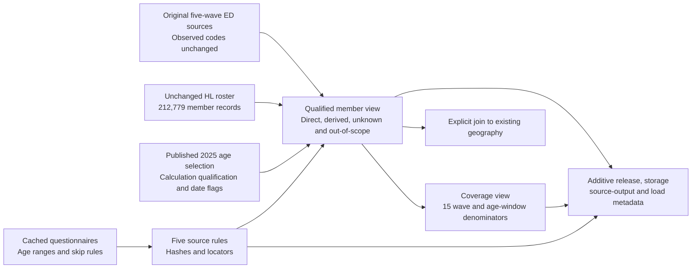

# CSES additional wave school attendance and denominators

The five-wave interface distinguishes direct answers, documented skips, unresolved responses
and members outside each questionnaire's age range. It covers 212,779 member-wave records in
1996, 1997, 1999, 2023 and 2025 without changing any original education or roster value.
One current-attendance concept is reviewed here, not the whole education module.

Published on 2026-10-18 as alignment release **19**, with three additive views and no changes
to existing source tables or analysis interfaces.

## Variable brief and eligible members

| Wave | Roster members | Questionnaire age range | Members within age range | Qualified denominator | Unknown or excluded within age range | Derived No from documented skip |
| --- | ---: | --- | ---: | ---: | ---: | ---: |
| 1996 | 46,811 | 5 and older | 40,968 | 40,968 | 0 | 0 |
| 1997 | 29,931 | 5 and older | 26,671 | 26,367 | 304 | 7,966 |
| 1999 | 32,348 | 5 and older | 29,002 | 28,990 | 12 | 8,255 |
| 2023 | 51,914 | 3 and older | 49,475 | 49,474 | 1 | 7,314 |
| 2025 | 51,775 | 3 and older | 49,455 | 49,454 | 1 | 6,674 |
| Total records | 212,779 | Wave-specific | 195,571 | 195,253 | 318 | 30,209 |

These are unweighted member records, not counts of people who directly answered the question
or unique people followed across surveys. The total denominator is an inventory count, not
a justified pooled analytical population. The interface retains all 17,208 members outside
the questionnaire age ranges, with null qualified attendance rather than invented No values.

The 1996 question explicitly includes school, university, training and vocational institutions.
The other four ask about being in the school system and have a separate non-formal-class
item. The 2023 and 2025 forms explicitly count school holidays as being in the school system;
the reviewed older forms do not provide that same explicit note. The interface therefore
keeps a concept-scope field and sets cross-wave equivalence certification to false. Matching
binary codes and age windows do not establish identical reference concepts.

2025 uses the [published native-age selection](cses-2025-age-interface.md), including its
formula and date qualifications. Other waves use their unchanged published source age;
no new exact-age or upper-age-code certification is made here.

## Attendance policy

`school_current_observed` and `school_ever_observed` preserve the existing standardized answers.
Their native codes remain in separate columns. Only `school_attendance_qualified` applies the
following bounded rules; it does not replace the source answer.

| Condition in a member record | Qualified value | Meaning |
| --- | --- | --- |
| Below the questionnaire age threshold, unknown age, or missing eligible education record | NULL | Outside scope or unknown, not No |
| Unrecognized native Yes/No code in either gate or current item | NULL | Preserve the code for review |
| Conflicting current/ever/grade answers | NULL | Conservative exclusion, not a claim that one source answer is wrong |
| Current answer present without a conflict or invalid code | Original 1 or 0 | Direct observed answer; a missing gate is separately flagged |
| Current answer missing, ever attended=No, documented skip, and no conflicting downstream information | 0, marked derived | Questionnaire-supported inference, not an observed response |
| Other missing current answer | NULL | Unanswered or unresolved |

1996 has no selected ever-attended gate, so no skip inference is applied to that wave.
For the other waves, an invalid current code such as 0 is not treated as a blank skip.
The historical rule used neutral code 0 for both 1997 and 1999. The
[subsequent level review](cses-additional-education-levels.md#1999-attendance-rule-erratum)
corrects that interpretation: 1997 code 0 means None, whereas 1999 code 0 means preschool
and 99 means None. Rechecking the 1999 records changes no existing attendance outputs;
the frozen v1 metadata must not be reused as a correct dictionary for future data.
Modern current-grade code 0 also means preschool/kindergarten. Missing current grade does not
erase a valid current-attendance Yes, although the missing grade remains flagged.

The qualified share is `qualified_yes / (qualified_yes + qualified_no)`. The denominator
includes explicitly flagged skip-derived No values but excludes unresolved records. The
coverage view also preserves the observed-only denominator and missingness bounds:
`qualified_yes / members` to `(qualified_yes + unknown_or_excluded) / members`.
These bounds cover unresolved attendance only, not survey-design uncertainty, age errors
or differences in questionnaire meaning. Do not treat them as confidence intervals.

## Unresolved cases

1997 has 304 unresolved records within the age range: 131 with conflicting routes or
downstream answers, 11 with unrecognized binary codes, 157 with both gate and current answers
missing, and five with current attendance unanswered after ever-attended=Yes. The 131 route
records are the distinct union of four never/Yes conflicts, 95 never-attended records with
substantive schooling-history or current-grade responses, and 35 current-No records with
a substantive current grade. These three counts overlap and must not be added.

The 11 native-code exceptions comprise nine current-attendance zeros and two ever-attended
zeros. Four additional education records have source age 0, below the form's minimum age;
they remain outside the age-qualified denominator. A valid current answer with a missing
gate remains visible and explicitly flagged rather than inferred from another item.

1999 retains all 12 previously reviewed missing-current responses after ever-attended=Yes.
2023 has one ever-attended code 3, absent from its Yes/No dictionary, despite an observed
current No. The qualified indicator excludes that record without erasing the observed No.
2025 has one age-eligible member with both gate and current attendance missing. None of these
unresolved values is filled from grades or automatically changed to No.

## Common age window diagnostics

Ages 6–17 are an analytical window inside all five questionnaire age ranges, not a claim about
statutory compulsory-school ages or identical school definitions. The percentages are
unweighted sample descriptions and are not national estimates.

| Wave | Members aged 6–17 | Qualified Yes | Qualified No | Qualified denominator | Unresolved | Qualified Yes percent | Observed-only Yes percent |
| --- | ---: | ---: | ---: | ---: | ---: | ---: | ---: |
| 1996 | 16,408 | 10,405 | 6,003 | 16,408 | 0 | 63.41 | 63.41 |
| 1997 | 10,052 | 6,466 | 3,557 | 10,023 | 29 | 64.51 | 86.05 |
| 1999 | 10,881 | 7,240 | 3,640 | 10,880 | 1 | 66.54 | 88.08 |
| 2023 | 11,992 | 10,410 | 1,582 | 11,992 | 0 | 86.81 | 88.81 |
| 2025 | 11,753 | 10,280 | 1,473 | 11,753 | 0 | 87.47 | 89.14 |

The 1997 qualified diagnostic differs from the earlier pilot sensitivity scenario because
it now excludes route conflicts and invalid codes. The old pilot counted contradictory
current responses as reported. Both historical evidence and original data remain unchanged.
For 2025, 109 members in this age window have incomplete birth dates, although native age
is present; the four first-visit calendar-age differences are outside this age window.

## Questionnaire evidence

| Wave | Cached source and locator | Review boundary |
| --- | --- | --- |
| 1996 | [Form 2 literal text](../data/processed/cses_questionnaires/additional_waves_v1/legacy_word_text_v1/1996/QuestENG_Form2.txt), printed page 6, columns 26–28 | Explicit 5+ heading and broad question; text extraction, not a new layout certification |
| 1997 | [Form 3 PDF](../data/processed/cses_questionnaires/additional_waves_v1/1997/forms/QuestENG_Form3.pdf), page 4, schooling Q4 | Rendered page reviewed: 5+ heading; columns 5 and 7 skip to 10 |
| 1999 | [Form 3 literal text](../data/processed/cses_questionnaires/additional_waves_v1/legacy_word_text_v1/1999/QuestENG_Form3Page.txt), II Schooling Q2 | Explicit 5+ heading; gate and current No skip to column 9; prior route evidence preserved |
| 2023 | [English household PDF](../data/processed/cses_questionnaires/additional_waves_v1/2023/forms/CSES2023_Household_Questionnaire_ENG_full.pdf), pages 12–13 | Rendered pages reviewed: 3+, gate/current skips, holidays, separate non-formal item |
| 2025 | [Literal cell cache](../data/processed/cses_questionnaires/additional_waves_v1/2025/text/CSES2025_Household_Questionnaire_ENG.json), `02 Education (2)` | B3, R10/R16, AH10/AH15/AH17, BJ10/BJ12; no electronic enablement reconstruction |

The rule view retains each source's SHA-256, locator, native variable names, age threshold,
neutral grade codes and qualification. The local evidence pins all five original ZIPs,
the selected HL/ED candidates, age-release evidence and implementation hashes. The 27 selected
native field-wave occurrences in the five education datasets were checked against archived
Stata values; that is source fidelity, not certification of all education variables.

## Database use and provenance

Use `cses_analysis.cses_additional_school_attendance_v1` for member-level analysis,
`cses_analysis.cses_additional_school_coverage_v1` for denominators and diagnostics, and
`cses_alignment.cses_additional_school_rule_v1` for the five source rules. The member view
contains 212,779 rows and 31 columns; the coverage view has 15 wave/age-window rows.

```sql
SELECT survey_wave, concept_scope, members, qualified_yes, qualified_no,
       qualified_denominator, unknown_or_excluded, inferred_no,
       qualified_unweighted_yes_pct
FROM cses_analysis.cses_additional_school_coverage_v1
WHERE age_band = 'ages_6_17'
ORDER BY survey_wave;

SELECT survey_wave, school_route_status, count(*) AS member_records
FROM cses_analysis.cses_additional_school_attendance_v1
WHERE school_age_eligible
  AND NOT qualified_denominator_eligible
GROUP BY survey_wave, school_route_status
ORDER BY survey_wave, school_route_status;
```

Join geography explicitly with `(survey_wave, household_key, record_key)`. Keys are native
composite strings, not longitudinal identities; do not cast the 2025 UUID keys to numbers.
Geographic code linkage does not certify village historical identity or map geometry.



The workflow is `align_cses_additional_school.py` followed by
`publish_cses_additional_school.py`: a local candidate, read-only exact-cell preflight,
fresh backup, transactional rollback rehearsal, additive publication and read-only postflight.
Existing physical tables, views, source catalogs and historical lineage files are not replaced.
The database registers the three new views and their source-output edges without re-registering
the existing surveys or native variables.

Release evidence is in `data/releases/cses-additional-school-attendance-v1/`; the full backup
is `data/backups/cses_additional_school_v1/before_school_attendance.dump`. Once published, do
not rerun publication against existing targets. Use only read-only verification:

```bash
.venv/bin/python rsc/cses_db/publish_cses_additional_school.py validate
.venv/bin/python rsc/cses_db/validate_cses_additional_school.py
```

The independent acceptance script reads the original Stata members and checks native keys,
codes, source ages, every route classification and the denominators using separate scalar
logic. Literacy, years attended, current-grade and highest-attainment harmonization remain
separate follow-up work; grade fields here support anomaly checks, not newly approved common
qualification categories.

Regression verification: 543 repository tests pass. The 15 focused school tests include
an independent scalar-versus-vector comparison over 576 response, age and grade combinations.
The local source acceptance passed for all 212,779 records before publication; its receipt
is `independent-local-checks.json`. Database acceptance has separate `validated.json` and
`independent-checks.json` receipts and uses `mda_readonly` in read-only transactions.

Both database checks passed for release 19: every one of the 212,779 member records matches
the source/scalar acceptance, all 15 denominator rows agree, and all member records retain
their existing geography link. Previous rows in 53 physical relations and the definitions,
columns and privileges of 107 existing relations are unchanged. The three new views have
29 registered dataset-output edges; no source catalog was replaced.
