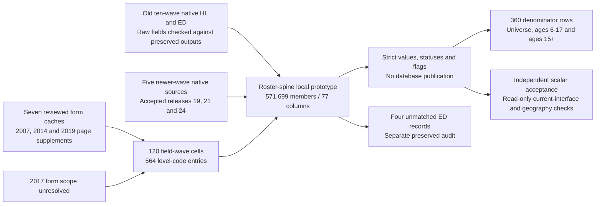

# CSES education comparison across fifteen survey waves

The accepted v2 result was subsequently published through an additive
[unified database interface](cses-education-unified-interface.md), release 26 on 2026-10-18.
This page and its local artifacts retain their original pilot-only scope; publication has
separate authorization, source inputs, execution evidence and database objects.

The current **local-only prototype v2** keeps all 571,699 member-wave records across 15 waves,
with 77 columns and eight education targets. It provides one schema without claiming identical
instruments or qualifications. Its 120-cell field-wave matrix distinguishes available native
items, component-derived literacy, unavailable fields and the unresolved 2017 questionnaire.
No database table, view, mapping, role or load registry was changed by this pilot.

Use `data/processing/cses/education_all_waves_pilot_v2/`, not the retained preliminary v1.
The original ten-wave interfaces and the five-wave releases 19, 21 and 24 remain unchanged.

## Population and qualified counts

| Wave | Roster members | Linked ED records | Printed age minimum | Combined literacy | Current attendance | Highest family | Current family | Observed years |
| --- | ---: | ---: | --- | ---: | ---: | ---: | ---: | ---: |
| 1996 | 46,811 | 46,811 | 5+ | 40,968 | 40,968 | 40,797 | Not collected | Not collected |
| 1997 | 29,931 | 26,675 | 5+ | 26,669 | 26,367 | 26,382 | 6,986 | Not collected |
| 1999 | 32,348 | 29,002 | 5+ | 29,002 | 28,990 | 29,002 | 8,049 | Not collected |
| 2004 | 74,719 | 74,719 | 5+ | 67,389 | 67,347 | 67,131 | 20,635 | Not collected |
| 2007 | 17,439 | 15,789 | 5+ | 15,788 | 15,769 | 15,756 | 4,748 | 13,113 |
| 2009 | 57,105 | 53,647 | 3+ | 53,629 | 53,641 | 53,598 | 14,223 | 41,114 |
| 2011-12 | 16,327 | 15,469 | 3+ | 15,462 | 15,467 | 15,467 | 4,034 | 12,746 |
| 2013 | 17,225 | 16,388 | 3+ | 16,386 | 16,381 | 16,386 | 3,995 | 13,665 |
| 2014 | 53,968 | 51,218 | 3+ | 51,218 | 51,192 | 51,184 | 12,067 | 40,916 |
| 2016 | 16,985 | 16,093 | 3+ | 16,092 | 16,071 | 16,081 | 3,675 | 13,723 |
| 2017 | 16,909 | 16,110 | Unverified | Withheld | Withheld | Withheld | Withheld | Withheld |
| 2019/20 (wave 2019) | 44,548 | 42,308 | 3+ | 42,307 | 42,308 | 42,298 | 10,604 | 34,810 |
| 2021 | 43,695 | 41,459 | 3+ | 41,455 | 41,452 | 41,453 | 10,158 | 34,770 |
| 2023 | 51,914 | 49,475 | 3+ | 49,475 | 49,474 | 49,472 | 12,303 | 42,159 |
| 2025 | 51,775 | 51,775 | 3+ | 49,425 | 49,454 | 49,454 | 12,620 | 42,780 |

Each target count is the number of non-null qualified member records, not the number answering
Yes or holding a particular degree. Highest/current families include explicitly distinct None,
Other and unspecified qualifications. Field counts overlap and cannot be added into respondents.
All frequencies are unweighted; proxy reporting is possible and repeated waves do not establish
longitudinal person identities. The 2011-12 combined data-wave label is retained.

| Target | Qualified records | Interpretation boundary |
| --- | ---: | --- |
| Combined literacy | 515,265 | 96,639 observed combined answers and 418,626 modern conjunctions; not one identical instrument |
| Reading | 418,682 | Separate simple-message item; unavailable separately in 1996/1997/1999 |
| Writing | 418,642 | Undefined codes are not converted to No |
| Ever attended | 474,145 | Observed valid binary answer, with other-item conflicts separately visible |
| Current attendance | 514,881 | Observed or explicitly marked non-conflicting skip-derived No |
| Highest family | 514,461 | Source-specific families, including marked never-attended derivations; not an ISCED ladder |
| Current family | 124,097 | Requires reported current attendance Yes; study is not a degree already held |
| Completed years attended | 289,796 | Observed, gate-qualified years only; no skip, grade or credential imputation |

The 120 matrix cells comprise 96 directly observed source-field correspondences, 12 possible
component-derived combined indicators, and 12 unavailable targets. The 96 include three legacy
combined items; the machine matrix labels those `observed_combined` and the other 93
`direct_native`. Availability means a raw field exists, not that its meaning or age universe
is certified. The eight 2017 targets retain their source availability but withhold strict values.

Coverage has 360 rows: eight targets, 15 waves and three age bands. Questionnaire-universe
counts respect each verified minimum; common ages 6-17 and 15+ provide consistent lower/upper
age bounds without age standardization. A missing verified minimum is represented as unknown,
not an empty population. The 2017 members have reported ages; it is their questionnaire age
universe that remains unverified. One 2004 member has unresolved analytical age.

## Questionnaire evidence updates

Three reviewed sources supplement, rather than overwrite, the historical seven-form review:

| Wave | Current evidence | Effect on this pilot |
| --- | --- | --- |
| 2007 | Complete English household PDF, physical page 6, education page 1 of 4 | Confirms age 5+, separate literacy, completed years, holiday instruction, gate skips and distinct highest/current code lists |
| 2014 | Published final report, physical page 221, printed 209, household page 8 of 54 | Supports the relevant items beyond the historical draft; current 21 remains postgraduate studies |
| 2019/20 | English bundle rendered page 16, complete image page visually checked | Confirms age 3+, literacy/year items, routing and distinct highest/current degree lists; OCR is not the transcription authority |

The pinned paths, hashes and exact locators are in
[the pilot specification](../rsc/specs/cses_education_all_waves_pilot_v1.json).
The first two are original PDFs; the 2019 rendered PDF is tied to the unchanged original DOCX
by SHA-256. Original workbook question/options caches for the seven earlier reviewed waves
remain pinned through `education_review_v1/review.json` and `questionnaire_alignment_v1/`.
The newer five-wave sources retain their accepted release evidence and native dictionaries.

The 2014 historical database correction still records its original user-approved draft basis.
The final-report supplement is new local evidence, not a rewrite of that historical approval.
No 2016 interpretation is transferred into 2017 education. All 16,909 members and 16,110
education records from 2017 remain available as source data; strict prototype indicators are
withheld with `unverified_same_wave_form_scope`, not reported as zero educational attainment.

## Meanings that cannot be collapsed

The codebook has 564 source-code entries, with highest and current dictionaries kept separate.
Ordinary grades have their own numeric fields; certificates and degree families do not become
school years or a single ordered score. Important examples are:

- 1996 highest 12 is a certificate/diploma, not literal Class 12.
- 2004 highest 90 is None, 98 is printed unknown, and observed 99 remains unrecognized.
- 2007 highest 13 is lower-secondary certification, but current 13 is pre-secondary vocational
  study. Current 16 in 2007/2009/2011-12 is unspecified postgraduate study.
- 2016 current 18 is further/continuing undergraduate study, not the Masters meaning in
  2019/2021/2023/2025. Current 21 is postgraduate study only in the reviewed 2013/2014/2016 scope.
- Modern highest 18 is Bachelor while current 18 is Masters. Current enrollment never proves
  that a degree has already been awarded.
- Earlier combined reading/writing answers are not split into two independent answers.
  A modern conjunction requires two valid component responses; an undefined writing code does
  not become No because the reading answer is No.

The 2017 level codebook remains empty pending same-wave source evidence. Its raw codes and
the old published broad groups remain untouched; a shared column name does not resolve them.
All strict results retain `cross_wave_equivalence_certified=false`.

## Routing and data exceptions

School and highest-attainment derivations require a documented never-attended skip with no
conflicting level, current-attendance or recorded-positive-years evidence. Other valid source
answers, such as literacy, are not discarded solely because attendance items conflict.
Observed years require ever-attended Yes, integer years 0-30 and years no greater than selected
source age. Zero is allowed when actually reported after Yes, but skipped blanks remain null.
The 0-30 interval is an analytical guard, not the printed maximum or proof that a larger value
is erroneous. A mean of qualified years describes qualified ever-attenders, not all members.

The raw-source review identified:

- Four historical ED records outside the roster: one in 2013 and three in 2014. They remain in
  `orphan_education.parquet` with original keys, source-row IDs and raw education fields.
- 24,761 roster members without an ED record. This is not a missing-response count: it includes
  members below the education age range and members in the unverified 2017 scope.
- Within the 14 verified questionnaire age universes, 50 eligible members lack ED records:
  2007 has 43, 2009 one, 2013 one, 2016 one and 2019 four. These stay distinct from skip blanks.
- Two year/age conflicts: 2021 reports six years at age five, and 2023 reports five at age four.
  Original ages and year values are retained; qualified years are null.
- One 2021 value of 50 years falls outside the current 0-30 processing guard. It is retained
  as a source value and excluded from this prototype, not labeled a proven questionnaire error.
- 24 records in reviewed-form waves report ever-attended No and positive years. Three additional
  2017 records have the same raw numeric combination but remain unverified-form diagnostics.

Preliminary v1 overlooked positive years when deriving skip-based current attendance and
never-attended attainment. Revision 2 removes only two resulting person-level inferences:
one 2009 member and one 2014 member, each affecting attendance and highest family. Their four
qualified field cells become unresolved; native answers and all published database values
remain unchanged. Other positive-years combinations were already excluded or did not support
those inferences. All seven existing qualified targets in the newer five-wave releases remain
exactly preserved over 212,779 records each.

Diagnostic flags on unverified 2017 records are provisional source-pattern screens, not certified
routing conflicts. For reviewed-route totals, filter `form_scope_reviewed=true`. Exception sets
overlap across fields and must not be summed into a count of unique problematic people.

## Local artifacts and topology

The current directory contains `members.parquet`, `orphan_education.parquet`, `matrix.json`,
`level_codebook.json` and `report.json`. The report pins every input and records source checks,
360 denominators, status counts and the exact v1-to-v2 changes. All data artifacts are under
Git-ignored `data/`; no SQL payload or large data file is committed by this workflow.



For existing geography, join exactly on `(survey_wave, household_key, record_key)`. Older keys
use the original padded identifiers; newer keys use the accepted native composite encoding.
No approximate identifier conversion, village-geometry certification or person matching across
waves is introduced. The published machine-readable lineage graphs remain historical snapshots.

## Reproduction and publication boundary

The first candidate and its evidence remain immutable. Revision 2 verifies them and applies
only the additional positive-years guard. From the repository root:

```bash
.venv/bin/python rsc/cses_db/pilot_cses_education_all_waves.py
.venv/bin/python rsc/cses_db/validate_cses_education_all_waves.py --database
.venv/bin/python rsc/cses_db/pilot_cses_education_all_waves_v2.py
.venv/bin/python rsc/cses_db/validate_cses_education_all_waves_v2.py --database
```

Omit `--database` for scalar-only acceptance after a candidate exists. The v2 builder requires
the first read-only acceptance receipt. Database checks force a repeatable-read, read-only
transaction under `mda_readonly`; they compare the relevant old HL/ED fields and corrected
groups, the accepted newer interfaces and the complete 15-wave geography key set. They do not
create a unified view. Changed inputs require a fresh candidate revision, not overwriting these
hash-pinned artifacts.

Before publication, approve the strict-versus-provisional presentation for 2017 and review the
positive-years guard and remaining exceptions. A later publication workflow must independently
implement and compare the full SQL projection, take a fresh backup, rehearse rollback and add
new versioned interfaces. No old view should be redirected or overwritten.

## Confirmed local acceptance

The current v2 candidate passed independent acceptance on 2026-10-18. The native builder
verified 571,699 roster records and 546,942 education-source records, retaining four orphan
ED records separately. The independent scalar validator checked 4,573,592 field-record
classifications, including unavailable/unverified cases, with zero mismatches, and reproduced
all 360 denominator rows and the 120-cell matrix counts.

Read-only database acceptance compared relevant fields in the existing ten-wave HL/ED
interfaces and the three accepted newer-wave education interfaces. It also verified exact
one-to-one key-set correspondence with all 571,699 existing geography records. No database
object was created or altered. The receipt is
`education_all_waves_pilot_v2/database-validation.json`, under `data/processing/cses/`.

The repository suite passed 608 tests, including 20 focused pilot tests and a 4,860-case
fifteen-wave age/gate/level boundary comparison. Lint and whitespace checks passed. These
results validate the prototype implementation, not universal comparability or resolution
of the source exceptions. Database publication and Git/DVC archival remain separate actions.
