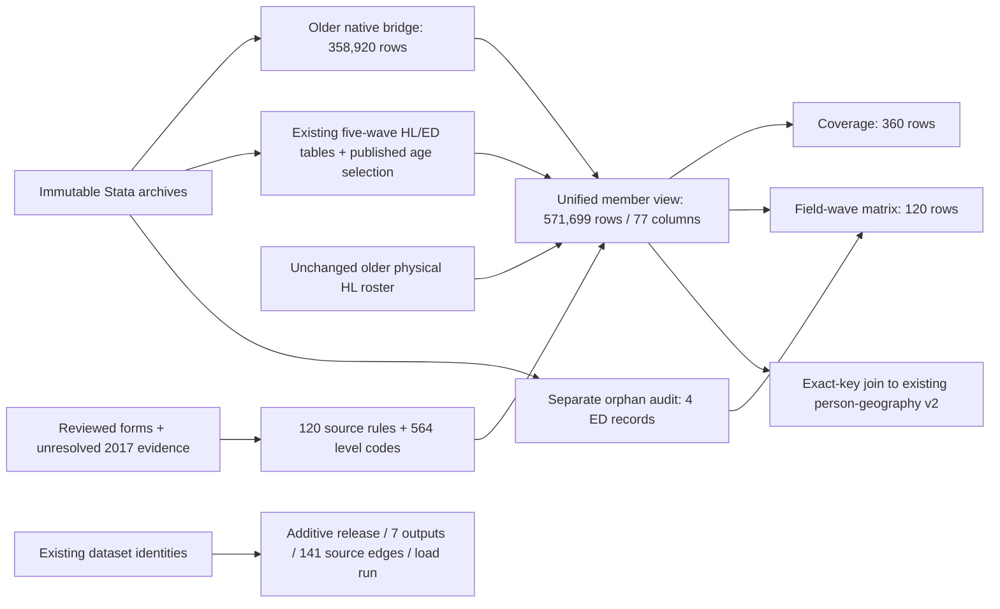

# Unified education interface across fifteen CSES waves

Published and independently accepted on 2026-10-18 as **alignment release 26**.

The interface keeps the full **571,699-member-wave roster**, rather than selecting only people
who have an education record or a usable answer. Its eight targets cover literacy, attendance,
educational level and observed years. A shared schema is not proof that every question,
qualification or respondent population is identical across years.

## Objects and analytical grain

| Database object | Rows | Purpose |
| --- | ---: | --- |
| `cses_analysis.cses_education_unified_v1` | 571,699 | One member-wave row, 77 columns; native inputs, qualified values, statuses and route flags |
| `cses_analysis.cses_education_coverage_v1` | 360 | Fifteen waves × eight targets × three age bands; explicit analytical denominators |
| `cses_analysis.cses_education_matrix_v1` | 120 | One field-wave row; source availability, questionnaire locator and counts |
| `cses_alignment.cses_education_source_rule_v1` | 120 | Static source variables, age minima, form scope and comparability boundaries |
| `cses_alignment.cses_education_level_codebook_v1` | 564 | Native highest/current code meanings by wave; general grades kept separate from credentials |
| `cses_data.cses_education_native_bridge_v1` | 358,920 | Older ten-wave roster keys, native age, ED-link flag and seven native ED inputs; no copied qualified values |
| `cses_data.cses_education_orphan_audit_v1` | 4 | One 2013 and three 2014 ED records without roster matches; original row identifiers retained |

Member keys are `(survey_wave, household_key, record_key)`. The member view uses the older
physical roster plus the native bridge, and the newer five-wave physical tables plus the
published age selection. The bridge is necessary because older canonical ED columns already
cleaned some undefined binary codes and values outside the school-years guard to NULL.
It restores access to native evidence without changing the historical canonical tables.

## Qualified coverage and use

| Target prefix | Non-null qualified member records | Boundary |
| --- | ---: | --- |
| `combined` | 515,265 | Legacy combined item or explicitly marked conjunction of separate modern reading/writing items |
| `read` | 418,682 | Not separately collected in 1996/1997/1999 |
| `write` | 418,642 | Undefined codes remain unresolved, not No |
| `ever` | 474,145 | Observed valid binary response; other-item conflicts remain visible |
| `attendance` | 514,881 | Observed response or marked, non-conflicting questionnaire-skip derivation |
| `highest` | 514,461 | Highest educational family; source-specific None/Other/unspecified and marked never-attended derivations |
| `current` | 124,097 | Current study family, conditional on reported current attendance Yes; not a qualification already held |
| `years` | 289,796 | Observed, route-qualified integer years 0–30; no skip, grade or credential imputation |

These are overlapping, unweighted member counts, not unique direct respondents or a panel.
Household answers can be proxy-reported. Neither the count of variables nor the count of rows
certifies universal cross-wave equivalence; `cross_wave_equivalence_certified` remains false.
The [accepted pilot](cses-education-all-waves-pilot.md#population-and-qualified-counts) retains
the full per-wave table and detailed questionnaire evidence.

For each target, use `*_qualified` with its `*_status`, `*_applicable` and
`*_expected_by_route`. Binary qualified values are 1/0; native binary codes remain 1/2.
Highest/current families are text, with ordinary grades in separate `*_general_grade`
columns. Do not average raw source codes or force vocational/degree families into years.

Coverage separates `questionnaire_universe`, `ages_6_17` and `ages_15_plus`.
The first follows the verified wave-specific age minimum; the common bands do not replace
source routing or age-standardize the sample. `qualified_records` is the usable-answer
denominator; `expected_by_route` includes unresolved expected answers. `raw_non_null` does
not imply a valid answer. These denominators are not interchangeable.

```sql
-- Inspect wave-specific coverage before estimating any rate.
SELECT survey_wave, age_band, target, age_band_members,
       expected_by_route, qualified_records, unresolved_expected
FROM cses_analysis.cses_education_coverage_v1
WHERE age_band = 'ages_15_plus' AND target IN ('read', 'write', 'years')
ORDER BY survey_wave, target;

-- Unweighted observed/qualified attendance share, not a national estimate.
SELECT survey_wave, count(attendance_qualified) AS usable_members,
       avg(attendance_qualified) AS attendance_share
FROM cses_analysis.cses_education_unified_v1
WHERE age_for_analysis BETWEEN 6 AND 17
GROUP BY survey_wave ORDER BY survey_wave;

-- Exact roster-key join. Geographic entity/geometry certification is separate.
SELECT e.*, g.admin1_code, g.admin2_code, g.admin3_code, g.admin4_code
FROM cses_analysis.cses_education_unified_v1 e
JOIN cses_analysis.cses_person_geography_v2 g
  USING (survey_wave, household_key, record_key);
```

Use the survey's design, weights and applicable sampling documentation for population
estimation. This interface does not harmonize or publish a new survey-weight contract.

## Explicit unresolved issues

- **2017:** all 16,909 members and 16,110 linked ED records remain accessible. Strict qualified
  values are withheld because same-wave questionnaire scope remains unverified. The unknown
  questionnaire-universe population is NULL, not zero. Reported age is not generally missing.
- **Positive years versus never attended:** two people in 2009/2014 have four otherwise
  inferred attendance/highest values withheld. Native answers are not corrected. Broader
  diagnostic flags are screens, not counts of independently proven errors.
- **Missing linkage:** 24,761 roster members have no linked ED record; most are outside the
  source education age range or in an unverified universe. Among the 14 verified universes,
  50 age-eligible members lack ED records. The four orphan ED rows are not fabricated members.
- **Age/years:** two native years-greater-than-age conflicts remain explicit, and one 2021
  response of 50 years is outside the 0–30 analytical guard, not automatically a proven error.
  Documented topcodes and the unverified 2025 calculated-age formula retain their limitations.

## Lineage and release evidence



No historical table, view, compatibility interface, source registration or frozen pilot is
replaced. New metadata rows append to existing registries; existing metadata prefixes remain
unchanged. No historical topology export is overwritten.
Select the new view explicitly for this qualification contract: older interfaces do not
automatically inherit its 2017 withholding or positive-years conflict guard.

Execution artifacts are in `data/releases/cses-education-all-waves-interface-v1/`.
`evidence.json` pins the approved pilot, native archives, form evidence and generated inputs.
`execution.json` pins SQL, publisher/support code, source identities, the prior database
snapshot and full four-schema backup. The backup is
`data/backups/cses_education_all_waves_v1/before_unified_education.dump`.
`rehearsal.json` records the rolled-back transaction; `published.json` confirms the committed
release. `validated.json` checks all new cells, summaries, metadata and unchanged old objects.
`independent-local.json` and `independent-database.json` record fresh native reads, independent
scalar decisions, denominators and read-only geography/source-interface acceptance.

Final acceptance found zero differences across all 571,699 × 77 member-view cells,
all four physical companion tables, 120 matrix rows and 360 coverage rows. Independent
classification verified 4,573,592 target-member decisions, and fresh native reads matched
all fifteen waves including the four orphan records. All 571,699 geography keys link one-to-one;
this is key retention, not certification of village geometry or historical boundaries.
The seven outputs and 141 source-output edges are registered. Existing rows in 55 physical
relations and the definitions/privileges of 116 prior relations were preserved. Full backup
decompression and rollback rehearsal passed, as did 615 repository tests and targeted lint.

The publisher is `rsc/cses_db/publish_cses_education_unified.py`; its independent SQL policy
is `cses_education_all_waves_sql.py`. After publication, use only the publisher's `validate`
action and `validate_cses_education_unified.py --database`. Do not rerun `publish` against
existing objects. Backups, Parquet inputs and generated receipts are data artifacts, not Git
payloads; this publication does not itself commit or push Git/DVC versions.
