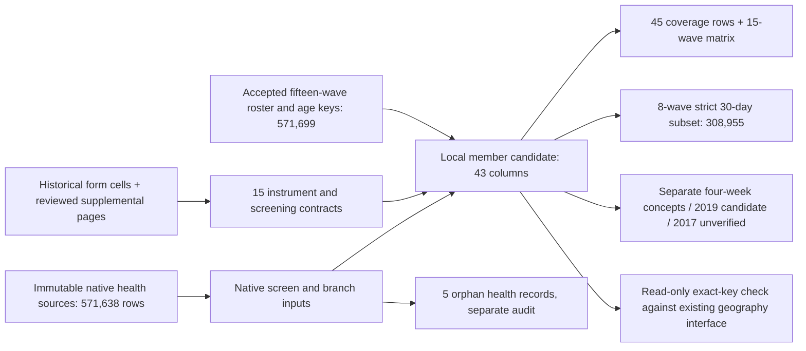

# Health screening comparison across fifteen CSES waves

**Database follow-up:** the accepted v2 contract is now published separately as
[release 28](cses-health-screen-interface.md). The local artifacts and validation receipts
below remain frozen pilot evidence; use the new named database interface explicitly.

The current **local pilot v2** preserves all 571,699 member-wave records and supports a
strict, form-supported 30-day illness/injury subset of **308,955 records across eight waves**.
It does not publish a new database interface. Four-week questions, different health topics,
unverified forms and unresolved coding remain separate rather than becoming healthy No answers.

The target is a household-proxy report of illness or injury now or during the last 30 days,
not a clinical diagnosis. Counts describe unweighted records in repeated cross-sections, not
direct respondents, unique people followed over time or population prevalence. Membership
in the roster is the operational spine; usual-residence definitions are not newly harmonized.

## Per-wave coverage and decisions

| Wave | Roster members | Selected health source rows | Within-instrument qualified screen | Strict 30-day records | Main qualification |
| --- | ---: | ---: | ---: | ---: | --- |
| 1996 | 46,811 | 46,811 | Not collected | 0 | Selected health topics include disability, under-five two-week diarrhoea and child-work health questions; none substitutes for a general recent-illness screen |
| 1997 | 29,931 | 29,931 | 29,832 | 0 | Major illness/injury/other health problem in four weeks; 98 skipped-branch flags and one undefined code 7 |
| 1999 | 32,348 | 32,348 | 32,344 | 0 | Four weeks including other healthcare need and preventive care; four missing screen answers |
| 2004 | 74,719 | 74,719 | 74,621 | 0 | Four-week illness/injury/other health problem; 98 explicit missing codes 9 |
| 2007 | 17,439 | 17,401 | 17,401 | 0 | Recovered form confirms a broader four-week question; 38 roster members lack health rows |
| 2009 | 57,105 | 57,082 | 57,082 | 57,082 | Form-supported 30 days; 23 roster members lack health rows |
| 2011-12 | 16,327 | 16,327 | 16,327 | 16,327 | Separately checked 2011 and 2012 forms support the same screening contract; combined data-wave label retained |
| 2013 | 17,225 | 17,225 | 17,225 | 17,225 | Form-supported 30 days |
| 2014 | 53,968 | 53,968 | 53,966 | 53,966 | Published final-report appendix supports the question; two missing roster health rows and two source orphans are distinct |
| 2016 | 16,985 | 16,985 | 16,981 | 16,981 | Three missing roster health rows, three source orphans, one skipped-branch flag |
| 2017 | 16,909 | 16,909 | Withheld | 0 | Same-wave health questionnaire remains unverified; raw code patterns are not a transfer authorization |
| 2019/20 (wave 2019) | 44,548 | 44,548 | 44,398, qualified candidate only | 0 | Code 2 means Injury in native labels but No in both inspected English form sources; 150 code-2 records withheld, entire wave outside strict default |
| 2021 | 43,695 | 43,695 | 43,689 | 43,689 | Five No-with-follow-up and one injury-with-illness-only flag |
| 2023 | 51,914 | 51,914 | 51,910 | 51,910 | Complete English form reviewed; three No-with-follow-up and one injury-with-illness-only flag |
| 2025 | 51,775 | 51,775 | 51,775 | 51,775 | Matching health-sheet screening prompts/options reviewed; electronic enablement logic remains unverified |

The strict eight-wave subset contains **56,262 Yes and 252,693 No** records. These are
inventory counts, not a pooled prevalence estimate. Within-instrument qualified screens
total 507,551, but that total mixes different concepts and periods and is not an analytical
denominator. The 353,353-record 30-day candidate layer additionally retains the qualified,
non-code-2 2019 records; it is not the strict default.

Zero strict records means that a wave is outside this particular default contract, not that
the data are absent or no one was ill. The 1996 source file also supplies the roster, so
having 46,811 source rows does not establish 46,811 answers to a recent-illness question.

## Evidence added to the historical review

The earlier ten-wave review and database release remain unchanged. The new local decisions use
the original cached source values and these additional questionnaire checks:

- **2007:** the complete household PDF explicitly prints survey year 2007. Physical pages
  41-43, section 14A, ask all usually resident members about illness, injury or other health
  problems over four weeks. Code 2 skips from screen column 6 to column 13. This resolves
  the earlier missing-health-form status, but does not turn the question into 30 days.
- **2011-12:** the distributed 2011 workbook and the separate 2012 household PDF, physical
  page 39, agree on the all-usually-resident-member universe, illness/injury now or within
  30 days, 1=Yes/2=No and No skip to column 7. The historical native screen/type suffix
  correspondence is retained. No separate 2012 records or year partition are invented.
- **2014:** the final report's physical page 250, printed 238 and household page 37/54,
  supports the same 30-day screening content beyond the previously reviewed draft.
- **2019/20:** the image-based form page 46 and official final-report physical page 260,
  printed 246, both establish the 30-day period and universe. Both print code 2 as No with
  a skip to column 4, while the native dictionary calls code 2 Injury. The branch resembles
  injury routing, but that does not adjudicate the conflicting option text. The 150 code-2
  answers remain raw; no corrected answer or definitive injury outcome is manufactured.
- **2023:** the complete English PDF, physical page 47, confirms 1=illness, 2=injury,
  3=No and the distinct illness-only branches. The two native health variants agree on
  every screening answer after exact person-key alignment, despite different row orders.
- **2025:** the two cached health-sheet variants have matching B2/B3/C7/C18/C25 screening
  content. The 2025 treatment field's illness-wide blanks are a separate unresolved issue,
  not missing illness-screen responses. Treatment-seeking is not derived in this pilot.

Questionnaire source paths, hashes, page/cell locators and rendered pages are pinned in
the local rules and reports. Form evidence does not certify the exact electronic interview
implementation or unrestricted comparability across all waves.

## Linkage and conservative exclusions

The native sources contain 571,638 rows. Exact within-wave person/household keys link
571,633 to the roster. Five unmatched health records remain in a separate source-grain audit:
two in 2014 and three in 2016. Conversely, 66 roster members lack health rows: 38 in 2007,
23 in 2009, two in 2014 and three in 2016. They remain in the member artifact with null
qualified health outcomes; they are never imputed as healthy.

Skipped-branch checks flag 109 distinct roster records: 98 in 1997, one in 2016, six in 2021
and four in 2023. These are conservative presence/routing screens, not 109 proven wrong
screen answers. The 1997 group includes symptoms, care responses, activity answers and
zero/nonzero visit counts in a branch the form says to skip. Source answers remain intact;
flagged records are excluded from the within-instrument qualified layer, not changed to Yes.
The checks cover the enumerated branch inputs, not every downstream variable or internal skip.

The 2023 native variants differ in one selected treatment input and three provider inputs,
but not the screening item. The treatment discrepancy overlaps one No-with-follow-up flag.
Provider-only differences do not discard otherwise usable screen answers. The raw counterpart
files and earlier variant review remain preserved.

The 2025 extended-missing sidecar has special-missing entries in other preventive-care fields.
None occurs in the selected screening or branch inputs. The original sidecar remains pinned;
these codes are not recoded as answers or used as evidence about the screen.

## Questionnaire copy integrity issue

**Follow-up:** an [archive-exact v2 cache and annual release audit](cses-health-screen-preflight.md)
now preserve all old copies while resolving the integrity guard for the new publication
candidate. The historical v1 cache described below remains unchanged and still fails its
own guard. Exact SQL preflight also identified missing branch inputs in the existing
additional-wave database table; the additive bridge is documented in that follow-up.

An additional whole-library check found seven XLS copies whose file hashes differ from the
historical questionnaire-cache manifest. Six are in 2004: `HH_DiaryQuestionnaire.xls`,
`HSES V20 ENG.xls`, `HSES V21 ENG.xls`, `Listing_Eng.xls`, `VillageQ_V16 ENG.xls` and
`Village_Questionaire.xls`. The seventh is the 2007 `Village2007.xls`.

All seven original archive members still match their historical fingerprints. Fresh,
macro-disabled extraction found zero differences in non-formula literal cells between the
archive members, changed copies and historical text caches. The screening question evidence
therefore remains unchanged. This does not establish identical formatting, formulas, macros
or workbook bytes, and the cause of the byte changes is not attributed.

The whole questionnaire cache still fails its strict binary-integrity guard. No copy or
manifest was repaired or overwritten. A future publication must resolve the copy-integrity
contract explicitly rather than bypass that guard. `form-copy-integrity.json` in the v2
directory records each affected path, original/current hash, compared cell count and the
separate native-health-cache verification. It is a supplemental receipt linked to the frozen
pilot and acceptance hashes, not a rewrite of their historical manifests.

## Artifacts and analysis contract

Use `data/processing/cses/health_all_waves_pilot_v2/` as the current local candidate.
The preliminary v1 and its independent acceptance are frozen. Revision 2 adds only the
separately reviewed 2012 form evidence, its strict-wave flag/status and 16,327 qualified values
for the combined 2011-12 data wave. Other native and qualified values remain identical.

| Artifact | Contents |
| --- | --- |
| `members.parquet` | 571,699 roster rows, 43 columns; native screen/branch inputs, source locators, linkage, instrument scope, qualifiers and flags |
| `sources.parquet` | 571,638 selected native-source rows, including the five orphans |
| `orphan_health.parquet` | Five unlinked native health records; not fabricated roster members |
| `rules.json` and `matrix.json` | Fifteen wave contracts, native labels, source/form provenance, counts and limitations |
| `coverage.json` | 45 rows: fifteen waves × all members, ages 6-17 and ages 15+ |
| `exceptions.parquet` | Missing health linkage, skipped-branch flags and unresolved source/form codes; not a count of unique survey errors |
| `report.json` | Immutable input/code/output hashes, denominators and version boundary |
| `database-validation.json` | Independent raw/scalar/count verification and forced read-only source/roster/geography acceptance |
| `form-copy-integrity.json` | Seven file-hash discrepancies, unchanged literal cells and verified original archive members |

`screen_binary_native` is a documented source mapping, not the strict analytical outcome.
`screen_qualified` additionally respects the specific instrument and conservative exclusions.
`illness_injury_30d_candidate` retains bounded 30-day candidates, including the explicitly
qualified 2019 subset. Use **`illness_injury_30d_qualified`** for the strict eight-wave local
subset, with `strict_30d_status`, source rules and explicit denominators.

There is no age minimum for this all-member health screen. The two common age bands are
descriptive subsets, not questionnaire eligibility cutoffs. Ages use the source-preserving
roster-age contract already accepted for the education interface, including its topcode and
2025 calculation limitations. Geographic-key retention is not verified village geometry.
No survey weights, population estimates, diagnoses, illness-type crosswalks or treatment
outcomes are harmonized here. `screen_imputed` and `cross_wave_equivalence_certified` remain false.

## Local topology and reproduction



```bash
.venv/bin/python rsc/cses_db/pilot_cses_health_all_waves.py
.venv/bin/python rsc/cses_db/validate_cses_health_all_waves.py --database
.venv/bin/python rsc/cses_db/pilot_cses_health_all_waves_v2.py
.venv/bin/python rsc/cses_db/validate_cses_health_all_waves_v2.py --database
.venv/bin/python rsc/cses_db/audit_cses_health_form_integrity.py
.venv/bin/python -m pytest -q rsc/tests/test_cses_health_all_waves.py
```

Builders refuse differing overwrites. The validators independently re-read all native inputs
and compare scalar screening decisions and denominators. Database transactions use
`mda_readonly` and are forced read-only; no table/view, release registry, prior artifact,
Git version or DVC pointer is modified. Publishing a new health interface is a separate step.

Final independent acceptance matched selected native screen/branch inputs across all 571,638
source rows, scalar decisions for all 571,699 roster records, fifteen matrix rows and 45
coverage rows, with zero mismatches. Read-only database checks matched source screens and
roster ages, and all 571,699 geography keys linked one-to-one. The complete suite passed
633 tests, including eighteen health-pilot tests; targeted lint and whitespace checks passed.
Separate comparison checks verified the supplemental literal-cell audit. These results do
not make the seven byte-different questionnaire copies pass the historical integrity guard.
