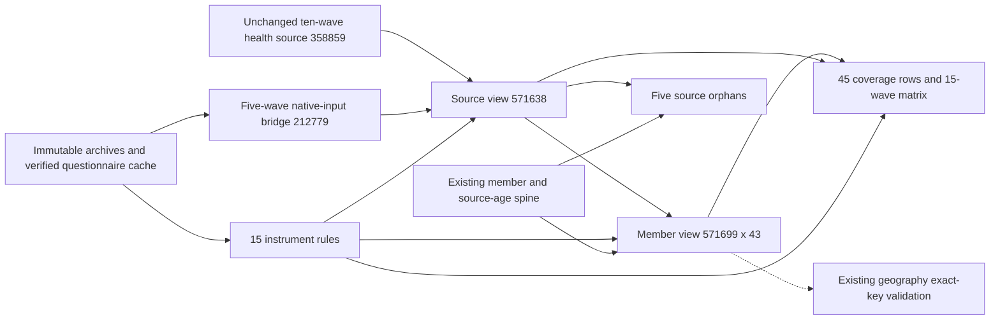

# CSES health screening database interface

**Release 28 was committed and independently validated on 2026-10-18.**
The interface is `cses_analysis.cses_health_screen_unified_v1` in **mda**. It retains
all **571,699 member-wave records and 43 columns**. The strict 30-day illness/injury outcome
has **308,955 qualified records across eight waves**, including 56,262 Yes and 252,693 No.
Existing health tables, views and qualification rules are not redirected to this interface.

## Analysis entry point

Use `illness_injury_30d_qualified` with its status and denominator, not `screen_binary_native`.
The latter is a native-code mapping and can include values excluded from qualified analysis.
These are household-proxy reports in repeated cross-sections, not clinical diagnoses,
unique longitudinal respondents or weighted population estimates.

```sql
SELECT survey_wave,
       count(*) AS roster_members,
       count(illness_injury_30d_qualified) AS strict_30day_records,
       count(*) FILTER (WHERE illness_injury_30d_qualified = 1) AS yes_records,
       count(*) FILTER (WHERE illness_injury_30d_qualified = 0) AS no_records
FROM cses_analysis.cses_health_screen_unified_v1
GROUP BY survey_wave
ORDER BY survey_wave;
```

Use `cses_analysis.cses_health_screen_coverage_v1` for all-member, ages 6–17 and ages 15+
denominators; these age bands are descriptive subsets, not minimum ages for the screen.
Use `cses_analysis.cses_health_screen_matrix_v1` for annual source/linkage counts, native
code distributions, status counts, original rules and verified questionnaire paths.

## Coverage and qualifications

The strict eight waves are **2009, 2011-12, 2013, 2014, 2016, 2021, 2023 and 2025**.
The [annual audit](cses-health-screen-preflight.md#fifteen-wave-check) lists every wave's
roster, missing-source, orphan and strict-outcome counts.

- All 66 members lacking health rows remain in the interface with missing qualified values:
  38 in 2007, 23 in 2009, two in 2014 and three in 2016.
- Five health-source records absent from the roster remain in a separate audit: two in
  2014 and three in 2016. They are not fabricated roster members or attached to nearby IDs.
- 1996 has other health topics but no selected all-member recent-illness screen.
- 1997/1999/2004/2007 retain their distinct four-week concepts; they are not recoded to 30 days.
- 2017 retains raw answers but withholds qualification pending verified same-year form scope.
- 2019 preserves 150 native code-2 answers that conflict with both inspected English forms.
  The entire wave is excluded from the strict default; the bounded non-code-2 candidate
  layer is separate and must not be mistaken for the strict outcome.
- The 109 branch-presence flags are conservative exclusions, not proven incorrect answers.
- Both 2011 and 2012 forms support the combined 2011-12 wave; no annual partition is invented.
- 2023 source variants are aligned by member keys, not row position. Provider-only differences
  do not disqualify otherwise usable screen answers. The selected treatment discrepancy is retained.
- 2025 treatment blanks, electronic enablement uncertainty and source-age qualifications remain
  separate from screening availability. Treatment and illness-type outcomes are not harmonized here.

`screen_qualified` mixes instrument-specific periods and concepts across 507,551 records.
`illness_injury_30d_candidate` additionally includes the bounded 2019 subset, totaling 353,353.
Neither total is a pooled prevalence denominator. No survey weights, imputation or blanket
cross-wave-equivalence certification are added.

## Geographic connection

All 571,699 member keys match the existing geography interface one to one. Join on all three
keys, including the wave; a matching household/person number in another wave is not the same key.

```sql
SELECT h.survey_wave, h.household_key, h.record_key,
       g.admin1_code, g.admin2_code, g.admin3_code, g.admin4_code,
       h.age_for_analysis, h.illness_injury_30d_qualified, h.strict_30d_status
FROM cses_analysis.cses_health_screen_unified_v1 h
LEFT JOIN cses_analysis.cses_person_geography_v2 g
  USING (survey_wave, household_key, record_key)
WHERE h.illness_injury_30d_qualified IS NOT NULL;
```

This preserves source administrative identifiers and existing geography qualifications.
It does not certify village coordinates, historical boundary identity or a stable village
entity across waves. Source-age selection retains the existing education-roster contract.

## Objects and source lineage

| Object | Kind | Rows | Purpose |
| --- | --- | ---: | --- |
| `cses_alignment.cses_health_screen_rule_v1` | Table | 15 | Frozen rules and verified form paths |
| `cses_data.cses_health_screen_additional_source_v1` | Table | 212,779 | Complete selected inputs for the five additional waves |
| `cses_analysis.cses_health_screen_source_v1` | View | 571,638 | Selected native inputs including orphans |
| `cses_analysis.cses_health_screen_unified_v1` | View | 571,699 | Member spine, 43 columns and qualified screen values |
| `cses_analysis.cses_health_screen_coverage_v1` | View | 45 | Wave and age-band denominators |
| `cses_analysis.cses_health_screen_matrix_v1` | View | 15 | Annual counts, status distributions and rule evidence |
| `cses_analysis.cses_health_screen_orphan_v1` | View | 5 | Health rows not linked to roster members |

The additional native-input bridge fills a reproducibility gap: the existing newer-wave
health JSON did not store 39,537 non-null branch cells needed by the accepted screening
checks. Original archive values and the accepted pilot are unchanged. This bridge preserves
the enumerated screen and branch inputs, not every field in every native health file.

The source manifest records 47 wave/purpose identities. Shared household/member files,
1996's shared member/health file and 2025's shared cover/household file are deduplicated into
**197 source-output edges** across the seven objects. The 2023 alternate health file is a
validation source, not a replacement screening source. Zero-orphan years remain in the
provenance checks with zero output rows rather than being omitted.



## Verification and release evidence

Formal publication committed all seven objects and their metadata atomically. The complete
registration rehearsal passed and rolled back before publication. Post-publication validation
passed as `mda_readonly` in forced read-only transactions: all source/member cells, actual
summary views, source identities, 197 metadata edges, fingerprints and privileges matched.
Old rows, definitions and permissions remain unchanged. Publisher revision 2 uses the
frozen SQL and explicit dependency order validated in the earlier object-only rehearsal.
Its complete transaction includes the objects, read-only grants, approved release, seven
storage records, 197 dataset-output links and one loaded-run record. It requires a matching
full-registration rollback rehearsal before committing.

The first complete rehearsal rolled back after the database timed out in a redundant orphan
`GROUP BY ... HAVING ... LIMIT 1` uniqueness query. Revision 2 compares every actual key and
cell, in order and with exact cardinality, against complete unique native-key sequences.
That equality proves database-key uniqueness without repeating the expensive anti-join
under a different optimizer row goal. The two newly created tables are analyzed for query
planning. No original answer, screening policy, SQL view definition or approved object changes.
Trial release ID 27 was rolled back; only ID 28 is the committed release. Sequence gaps from
rollback are not missing data or an omitted published release. The full test suite passed
**654 tests**; changed implementation/test files pass targeted Ruff checks. The three known
style findings in the frozen school-attendance source remain outside this publication.

An independent acceptance re-read the original Stata members for all 15 waves and checked
all 571,638 source rows. It independently recalculated scalar screening decisions for every
one of the 571,699 published member rows and all 45 age-band denominator rows: **zero native,
scalar or denominator mismatches**. The strict outcome remains 308,955 records and 56,262 Yes.
The release registry is `approved`, with one `loaded` run. The four CSES schemas now contain
61 physical relations and 47 views (108 total); preserved public relations are outside that count.

Evidence is stored under `data/releases/cses-health-screen-interface-v1/`: `evidence.json`,
`source-lineage.json`, frozen `execution.json`, `execution-v2.json`, `rehearsal-v2.json`,
`published.json`, `validated.json` and `independent-native.json`.
The new four-CSES-schema backup is under `data/backups/cses_health_screen_publication_v1/`.
Its archive is fully decompressed for verification; it is not a whole-mda/public backup,
and no restore into a PostgreSQL server is claimed.

The accepted [pilot](cses-health-all-waves-pilot.md), [preflight](cses-health-screen-preflight.md),
historical questionnaire copies and all earlier releases remain preserved. Current questionnaire
evidence uses the separate `archive_verified_v2` cache where applicable; the old v1 library
still contains the documented seven byte-different XLS copies and is not labelled repaired.

After publication, use only the read-only verification action, not another publication:

```bash
.venv/bin/python rsc/cses_db/publish_cses_health_screen_v2.py validate
.venv/bin/python rsc/cses_db/validate_cses_health_screen_native.py
```
