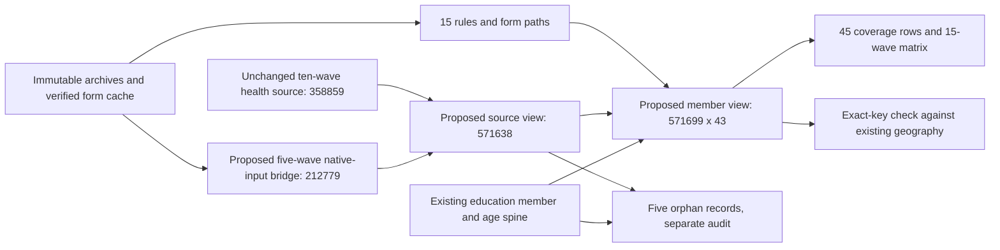

# Health screening: annual audit and additive interface preparation

**Publication follow-up:** the accepted objects were committed separately as release 28.
Use the [published interface and SQL brief](cses-health-screen-interface.md) for database
access. This document and its receipts remain the preserved pre-publication audit, not a
rewrite of that historical authorization boundary.

This work prepares a new health-screening interface; **it is not a production release**.
The accepted local v2 pilot remains unchanged. It retains 571,699 member-wave records,
of which 308,955 have qualified 30-day illness/injury screening values across eight waves
(56,262 Yes; 252,693 No). These are unweighted repeated-cross-section inventory counts,
not unique longitudinal respondents, clinical diagnoses or pooled prevalence estimates.

## Questionnaire cache integrity

`data/processed/cses_questionnaires/archive_verified_v2/` is the new archive-exact cache.
It contains 76 original source files and 139 total artifacts, including derivatives. The
76 originals include reference files; this is not a count of 76 distinct questionnaires.
Every original payload was re-read from its immutable archive and matched the historical
manifest hash. Derivatives were copied only after their historical hashes matched.

The seven byte-different historical XLS copies and the entire v1 manifest were preserved.
The old v1 library still fails its binary guard; it must not be presented as repaired.
The new cache passes its own full guard. Its manifest hash is
`e51e1cdfbdc4a21338ee8b5ab9dddf9a0f36877138ed20019efc57ff02ffec41`.
The verification receipt records every old/new fingerprint and confirms no v1 mutation.
The previous literal-cell comparison does not certify identical formulas, macros or layout.

Frozen pilot rules retain their historical paths and hashes. The proposed new rule table
adds `verified_form_path`, pointing to identical literal evidence in the verified cache
where relevant, without rewriting those frozen rules. Supplemental same-year forms and
reviewed report appendices retain their separately pinned paths.

## Fifteen-wave check

All 571,638 selected native source rows were independently re-read. Member keys and every
selected screen/branch value matched the frozen pilot exactly. Variable labels and attached
screen-code dictionaries also matched. The full verified negative-screen skip ranges were
checked, adding 1999 fields `p8c16`–`p8c18` and 2004 fields `q14a08`–`q14a12` beyond the pilot's
enumerated branch inputs. All additional fields were null in negative-screen records:
**zero newly missed negative-branch conflicts**. Later preventive-care and smoking items
were not incorrectly treated as skipped illness branches.

| Wave | Roster members | Members missing health rows | Health rows without roster members | Strict 30-day records |
| --- | ---: | ---: | ---: | ---: |
| 1996 | 46,811 | 0 | 0 | 0 |
| 1997 | 29,931 | 0 | 0 | 0 |
| 1999 | 32,348 | 0 | 0 | 0 |
| 2004 | 74,719 | 0 | 0 | 0 |
| 2007 | 17,439 | 38 | 0 | 0 |
| 2009 | 57,105 | 23 | 0 | 57,082 |
| 2011-12 | 16,327 | 0 | 0 | 16,327 |
| 2013 | 17,225 | 0 | 0 | 17,225 |
| 2014 | 53,968 | 2 | 2 | 53,966 |
| 2016 | 16,985 | 3 | 3 | 16,981 |
| 2017 | 16,909 | 0 | 0 | 0 |
| 2019 | 44,548 | 0 | 0 | 0 |
| 2021 | 43,695 | 0 | 0 | 43,689 |
| 2023 | 51,914 | 0 | 0 | 51,910 |
| 2025 | 51,775 | 0 | 0 | 51,775 |
| Total | 571,699 | 66 | 5 | 308,955 |

The source/roster partition is exact: 571,633 linked rows, 66 roster-only records and five
health-only records. No source or roster key is null or duplicated. Missing health records
remain in the member interface; health-only records stay in a separate audit.

The following exclusions remain intentional:

- 1996 has other health topics but no selected all-member recent-illness item.
- 1997/1999/2004/2007 have distinct four-week concepts, not a 30-day crosswalk.
- 2017 lacks verified same-year form scope; matching data patterns do not authorize a 2016 transfer.
- 2019 has 150 native code-2 answers labelled Injury while both reviewed English forms print No.
  The disputed values remain raw and the whole wave remains outside the strict default.
- The 109 skipped-branch flags are conservative eligibility exclusions, not proven erroneous answers.
- The combined 2011-12 data wave is not split into invented annual records.
- 2023 variants are aligned by person key, not row order. A treatment discrepancy and three
  provider discrepancies do not justify discarding all otherwise usable screening answers.
- 2025 treatment blanks and electronic enablement uncertainty do not become missing screen answers.

The [pilot brief](cses-health-all-waves-pilot.md) explains concept definitions, questionnaire
locators, denominators and qualifications. This audit covers screening and its verified skip
ranges, not harmonization of every follow-up variable or every health questionnaire topic.

## Database omission found during preflight

The first proposed six-object design attempted to reconstruct all screening inputs from the
existing database health JSON. Exact comparison stopped it: the newer-wave table deliberately
retained only selected fields, not the complete native health record. It lacks **39,537
non-null branch cells** needed to reproduce the accepted pilot. Native screening answers
themselves matched; this is a storage-input omission, not missing original survey data.

| Wave | Source records affected | Examples of native fields absent from existing JSON |
| --- | ---: | --- |
| 1997 | 4,013 | `p8c6`, `p8c8`, `p8c10`–`p8c14` |
| 1999 | 3,383 | `p7c6`, `p8c9`, `p8c11`–`p8c15` |
| 2023 | 10,277 | `q13bc04`, `q13bc05` |
| 2025 | 262 | `q13bc04`, `q13bc05` |

Every observed difference was an absent database value where the original had a value,
not a disagreement between two non-null values. The 1996 selected source has no general
recent screen and showed no such difference. The existing ten-wave health source contained
all selected inputs. Existing tables and all previously accepted local results are preserved.

The revised design therefore adds a separate **212,779-row native-input bridge for all five
additional waves**. It preserves the complete enumerated screening/branch inputs, row number,
source ID, household link and field-specific variant flags. Native member hashes and field
names remain in the accompanying rules. It does not purport to store every native health field.

## Proposed objects and topology

| Object | Kind | Rows | Purpose |
| --- | --- | ---: | --- |
| `cses_alignment.cses_health_screen_rule_v1` | Table | 15 | Frozen instrument rules plus verified form paths |
| `cses_data.cses_health_screen_additional_source_v1` | Table | 212,779 | Source-preserving inputs for the five additional waves |
| `cses_analysis.cses_health_screen_source_v1` | View | 571,638 | All selected source rows, including orphans |
| `cses_analysis.cses_health_screen_unified_v1` | View | 571,699 | Member spine, 43 columns, native values and qualified outcomes |
| `cses_analysis.cses_health_screen_coverage_v1` | View | 45 | Fifteen waves × all members / ages 6–17 / ages 15+ |
| `cses_analysis.cses_health_screen_matrix_v1` | View | 15 | Annual counts, native-code/status distributions and rule provenance |
| `cses_analysis.cses_health_screen_orphan_v1` | View | 5 | Source rows absent from the member spine |



Geographic keys link to all member records; this does not certify village coordinates or
historical boundary geometry. No weights, diagnoses, illness-type crosswalk or treatment
outcome is added. `screen_imputed` and `cross_wave_equivalence_certified` remain false.

## Verification and release boundary

The revised independent SQL preflight passed: all 571,638 source rows and all 571,699 × 43
member cells match the accepted pilot exactly, as do the five orphans, 45 coverage rows,
15 annual matrix rows and 571,699 geographic keys. The protected baseline contains 59 physical
relations and 123 total relations. The four-CSES-schema backup is **64,630,138 bytes** and
has passed full archive decompression. It is not a whole-mda/public-schema backup, and an
actual restore into a PostgreSQL server was not performed.

The first object rehearsal rolled back after detecting a DDL dependency-order error:
canonical JSON sorts object names, placing a summary view before its member-view dependency.
The frozen preflight v2 was preserved. A separate v3 rehearsal uses an explicit dependency
list, with no changes to SQL definitions, inputs, backup or screening eligibility. **The v3
rehearsal passed** with zero cell/count mismatches as `mda_readonly`, then unconditionally
rolled back. All seven proposed objects are absent afterward; previous rows, definitions
and permissions are unchanged. Its successful receipt is
`data/releases/cses-health-screen-interface-rehearsal-v3/rehearsal.json`; do not use the superseded
`prepare_cses_health_screen_interface.py rehearse` action.

The completed rehearsal tested the two new tables, five new views, exact values and read-only
grants. It did **not** rehearse formal release/storage/source-output
registration. Production publication and its metadata transaction require a separate approved
execution plan and final registration checks. No production commit action exists in this
preparation tool. A successful rollback test is not itself a published release.

The full repository suite passes **644 tests**; the targeted suite passes 11 tests, including
two new dependency-order and unconditional-rollback guards. All seven new/changed implementation/test files in
this step pass targeted Ruff checks, and edited documentation passes whitespace and local-link
checks. A whole-directory Ruff run still reports three pre-existing `E702` style findings in
the frozen `align_cses_additional_school.py` (lines 157, 163 and 214). That source is pinned
by historical releases and was deliberately not reformatted during this health task.

Evidence locations:

- `data/processed/cses_questionnaires/archive_verified_v2/{manifest,verification}.json`
- `data/processing/cses/health_release_audit_v1/{annual,report}.json`
- `data/processing/cses/health_database_input_audit_v1/report.json`
- `data/releases/cses-health-screen-interface-preflight-v1/evidence.json`: superseded,
  six-object candidate stopped before preparation; not a successful execution receipt.
- `data/releases/cses-health-screen-interface-preflight-v2/`: revised bridge, rules and receipts.
- `data/releases/cses-health-screen-interface-rehearsal-v3/`: dependency-ordered rehearsal plan and receipt.
- `data/backups/cses_health_screen_preflight_v2/before_health_screen.dump`: local-only backup.

Reproduction uses immutable outputs and refuses differing overwrites:

```bash
.venv/bin/python rsc/cses_db/rebuild_cses_questionnaire_archive_cache.py
.venv/bin/python rsc/cses_db/audit_cses_health_release.py
.venv/bin/python rsc/cses_db/audit_cses_health_database_inputs.py
.venv/bin/python rsc/cses_db/prepare_cses_health_screen_interface.py build
.venv/bin/python rsc/cses_db/prepare_cses_health_screen_interface.py prepare
.venv/bin/python rsc/cses_db/rehearse_cses_health_screen_v3.py build
.venv/bin/python rsc/cses_db/rehearse_cses_health_screen_v3.py rehearse
.venv/bin/python -m pytest -q
```

Database steps require local mda access. `prepare` performs forced read-only comparisons
as `mda_readonly`, protects old database fingerprints and creates a four-schema backup.
`rehearse` takes scoped locks and only temporary transactional writes. `prepare` deliberately
refuses to replace an existing backup/execution plan. None of these commands commits Git,
pushes DVC, overwrites old database outputs or performs formal publication.
