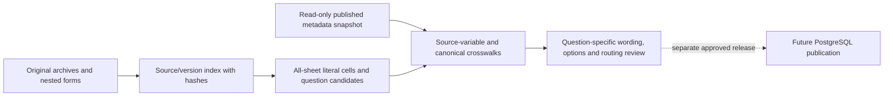

# CSES questionnaires by survey wave and question correspondence

## Archive-exact cache integrity follow-up (2026-10-18)

Use `data/processed/cses_questionnaires/archive_verified_v2/` for the newly verified copy of
the historical library: 76 original source files and 139 total artifacts match historical
hashes. Seven byte-different old XLS copies and the v1 manifest were retained unchanged.
Official/additional supplements remain in their existing separate directories. This changes
neither the material-availability inventory nor the frozen pilot evidence. See the
[cache verification and health preflight](cses-health-screen-preflight.md#questionnaire-cache-integrity).

## Current materials audit (2026-10-03)

**Updated 2026-10-16:** the complete 2023 English household questionnaire has now been downloaded
and archived locally. Its 66 pages reproduce physical pages 205–270 of the official NIS report,
including the original blank verso after the cover. Open the
[2023 questionnaire directory](../data/processed/cses_questionnaires/additional_waves_v1/2023/README.md).
The remaining 2023 local gaps are the village questionnaire and household listing form.
The original 2026-10-03 inventory counts below remain a historical snapshot.

**Further retrieval on 2026-10-16:** six direct NIS PDFs for 1997/1999/2011 are now archived,
and the 2019/20 village questionnaire was recovered from the official report. Open the
[current questionnaire index](../data/processed/cses_questionnaires/README.md) or
[official supplement](../data/processed/cses_questionnaires/official_retrieval_v1/README.md).
The 2011 diary cover explicitly says 2011, closing its prior version gap. A NIS-authored 1997
bundle hosted by IHSN also supplies a 12-page village scan with continuous printed pages 1-12.
The separate 11-page digital village PDF also reaches Q89; pagination differs and is not, by
itself, proof of missing questions. Both variants and the full 46-page bundle are retained.

**Priority follow-up, later on 2026-10-16:** no additional missing original form was recovered
for 2017/2021/2023. The previously uninspected official 2021 Khmer report is now downloaded
(312 pages, 489,257,776 bytes); its contents and appendix were visually screened. Its Form 3
household appendix does not close the village/listing/diary gaps, and it has no embedded files.
A third-party Scorocs paper citing the 2017 household questionnaire is archived as a source lead,
not as the original form. See the [priority search ledger](../data/processing/cses/materials_priority_search_20261016/README.md)
and [reference manifest](../data/processed/cses_questionnaires/official_retrieval_v1/manifest_priority_search_20261016_v1.json).

This section supersedes older **availability** statements below and in the immutable v1 library.
It audits materials, not variable alignment. Current loose files matter: the original ZIPs alone
omit several household/village forms now present in `data/raw`. Report appendices and forms
embedded in a combined document also count as available; filenames alone do not establish year,
language, instrument type or final-version status.

The audit scanned 154 document occurrences (95 distinct byte hashes, including reports, manuals
and code references, **not 95 questionnaires**) across current loose files and 24 ZIP/RAR container
occurrences, including nested/duplicate containers. It inspected all-sheet text, PDF page text,
legacy Word text and the 2019 image-based bundle. No extraction errors were reported. Sources,
archive inventories, hashes, cell/page evidence and diagnostics are in
`data/processing/cses/materials_audit_v1/`. Reproduce the source inventory with the bundled
document Python and `rsc/cses_db/audit_cses_materials.py`. No database connection, source edit,
Git commit or DVC publication was made.

### Local availability by year

The combined 2011–12 data wave is split here because the documents have distinct survey years.
"Not located" means absent from the inspected local material, not unavailable worldwide.
Household-member modules are part of the household questionnaire, not a missing standalone
individual questionnaire. Listing means the **sampling household-listing form**, not the member roster.

| Year | Household form | Village form | Diary | Household listing | Material action |
| --- | --- | --- | --- | --- | --- |
| 1996 | English Form 2 present | Not a separate required form in the NIS instrument list | Not part of the listed design | Not located | Obtain Form 1; Form 3 appointment slip is also absent but lower priority |
| 1997 | English Forms 3 and 4 present | **11-page digital PDF and 12-page scan archived** | Form 4 is a social-sector module, not a diary | **Official 3-page PDF archived**; full IHSN bundle also retained | No missing form among these categories; pagination variants retained separately |
| 1999 | English core form/cover and income-employment Form 4 present | **Official 13-page PDF archived** | Form 4 is income/employment, not a daily diary | **Official 4-page PDF archived** | No missing form among these categories |
| 2004 | Present | Present | Present, including Time Use sheet | Present | No missing instrument among these categories |
| 2007 | **50-page English PDF present** | XLS and 17-page English PDF present | Four-page PDF present, but cover says **2003–04** | Not located | Obtain listing; verify the diary's applicability to 2007, do not classify the household form as missing |
| 2009 | Present | Present | Present | Present in final report appendix | No missing instrument among these categories |
| 2011 | English household XLS present | **Official 17-page PDF, cover dated 2011, archived** | **Official 3-page PDF, cover dated 2011, archived**; older 2010-cover XLS retained separately | Not located | Obtain listing; village and diary-year gaps closed |
| 2012 | **53-page English PDF present** | **17-page English PDF present** | Not listed in the three-form design | Not located | Obtain listing; village PDF metadata refers to a draft source, so version qualification remains |
| 2013 | English XLS variants present | **English XLS present** | Not listed in the three-form design | Not located | Obtain listing, not the already-present village form |
| 2014 | **Published final-report appendix present**, in addition to draft XLSX | **Report appendix present** | **Report appendix present** | **Report appendix present** | No content gap among these categories; a separate final XLSX is not required to establish questionnaire availability |
| 2016 | English XLSX variants present | English XLS variants present | Not listed in NIS's three-form instrument section | Not located | Obtain listing; do not assert a lost diary merely because no diary file exists |
| 2017 | **Not located** | **Not located** | No local file; requirement not independently established | **Not located** | Highest-priority household/village/listing gap; archive contains 35 DTA files only |
| 2019/20 | Present in English DOCX | **Official report appendix archived as a 10-page PDF** | Present in the same DOCX | Present in the same DOCX | No missing instrument among these categories |
| 2021 | English and Khmer XLSM present; official report household appendices also checked | **Not located** | **Not located** | **Not located** | Obtain village, diary and listing; both-language report checks do not close these gaps |
| 2023 | **Complete English body archived 2026-10-16 (66 pages)**; Khmer body also present; old one-page English cover retained | **Not located** | **Explicitly not used** | **Not located** | Obtain village and listing forms; English-body gap closed |
| 2025 | English 64-sheet XLSM present | Not located | No local file; requirement not established | Not located | Ask for the actual instrument/package list and village/listing forms if used; do not invent a diary requirement |

### Corrections backed by local files

- **2007:** `data/raw/CSES 2007/Questionnaire/KHM_2007_CSES_hh_questionnaire.pdf`
  has 50 pages, a 2007 household cover and substantive sections. Despite the `KHM` filename
  prefix, the inspected text is English. The diary PDF in the same directory explicitly prints
  2003–04 on page 1. A document exists; same-year applicability is not established by its filename.
- **2012:** `data/raw/CSES 2011-12/Questionnaire/CSES2012_HH_Questionnaire.pdf`
  and `CSES2012_Village_Questionnaire.pdf` print 2012 on their covers. The directory also contains
  the 2012 field manual and report. The village PDF's metadata title is
  `CSES2012 Village ENG_Draft_29.11.2011.xls`; present and final-version-certified are different statuses.
- **2013:** `data/raw/CSES2013/CSES2013 Village Questionnaire.xls`, sheet `Cover!A7`,
  explicitly says village questionnaire 2013. Its `Sections` sheet contains 1,115 literal cells.
  The adjacent loose household workbook is another retained variant, not an absent household form.
- **2014:** `data/raw/CSES 2014/CSES_2014_Report.pdf` contains the actual forms, not just references:
  physical PDF pages 198–201 listing, 204–212 village, 214–267 household, and 270–272 diary.
  Appendix divider pages are 197, 203, 213 and 269. Physical PDF page numbers avoid the report's
  inconsistent/repeated printed pagination. The published household cover prints 2014.
- **2009:** `data/raw/CSES 2009/Final Report CSES 2009.pdf`, physical pages 171–174,
  supplies the 2009 listing form. Its appendix contents also mention other instruments, but
  that alone is not evidence that those pages are inside this particular PDF; the separate
  household/village/diary workbooks establish their availability.
- **2019/20:** `data/raw/CSES2019/Forms of CSES 2019-20-English​.docx` renders to 69 pages:
  listing at pages 2–4, household at pages 6–63, diary at pages 65–69, with divider pages 1/5/64.
  It has 66 embedded image assets. The RAR contains a byte-distinct DOCX variant with the same
  instrument headings and 66 byte-identical embedded images; both were inspected. All 69 rendered
  pages were also screened with OCR for instrument/section identification, with boundary-page
  visual checks. OCR is a discovery aid here, not approved question transcription. No village form
  was located in either bundle.
- **2011 diary:** `CSES 2011 Diary ENG.xls`, sheet `Cover!A6`, prints 2010. The NIS description
  says 2011 maintained the 2010 design, which supports possible reuse but does not independently
  certify the provenance of this exact file. On 2026-10-16 a separate official three-page PDF
  whose cover explicitly says 2011 was retrieved and archived. Use that same-year source for
  the current materials inventory; retain the older workbook as a distinct historical version.

### Evidence for which forms were actually required

Do not apply a universal four-form checklist to every year:

- [NIS 1996 instrument description](https://microdata.nis.gov.kh/index.php/catalog/34) lists
  household listing, household questionnaire and appointment slip; it does not establish a
  separate village questionnaire or diary requirement.
- [NIS 1997 resource catalog](https://microdata.nis.gov.kh/index.php/catalog/11/related-materials)
  lists all four contemporary forms and provides listing/village download entries. These two
  original PDFs are now archived in the 2026-10-16 supplement. The separate NIS-authored
  [IHSN bundle](https://catalog.ihsn.org/catalog/27/related-materials) supplies a 12-page village scan.
- [NIS 2011 description](https://microdata.nis.gov.kh/index.php/catalog/17/study-description)
  lists four forms. [2012](https://microdata.nis.gov.kh/index.php/catalog/18) and
  [2013](https://microdata.nis.gov.kh/index.php/catalog/19) list three forms without a diary.
  The local 2014 final report, physical page 129, says the diary was reintroduced after removal
  in 2012/2013. The 2012 manual still contains diary references, a documentation inconsistency;
  it is not sufficient to label the absent 2012 diary as a confirmed missing instrument.
- [NIS 2016 description](https://microdata.nis.gov.kh/index.php/catalog/42), instrument section,
  lists three forms. Its historical boilerplate should not independently create a diary requirement.
- The [2017 final report](https://www.nis.gov.kh/nis/CSES/Final%20Report%20CSES%202017.pdf),
  printed page 2, says the household questionnaire had minor changes from 2016. An earlier year's
  form does not close the 2017 source-document gap. The NADA 2017 entry contains inconsistent
  2013 dates, so it is not treated as definitive evidence of all 2017 instruments.
- The [2021 NIS report](https://www.nis.gov.kh/nis/CSES/Final%20Report%20of%20Cambodia%20Socio-Economic%20Survey%202021_EN.pdf),
  section 1.7 and printed pages 9–10, describes household, village, listing and diary forms.
- The [2023 NIS report](https://www.nis.gov.kh/nis/CSES/Final%20Report%20of%20Cambodia%20Socio-Economic%20Survey%202023_EN.pdf),
  section 1.7, printed page 9, explicitly excludes the diary. Its English household appendix
  begins at printed page 187 (physical PDF page 203); the cover is physical page 205 and
  substantive questions follow. **The complete English body was archived locally on 2026-10-16**:
  `data/processed/cses_questionnaires/additional_waves_v1/2023/forms/CSES2023_Household_Questionnaire_ENG_full.pdf`.
  It contains report PDF pages 205–270, ending with the victimization continuation, and excludes
  page 271 (publisher information). The old one-page English cover remains historical evidence.

The immediate content priorities are therefore 2017 household/village forms,
village forms for 2021/2023, and the 2021 diary. Listing forms
are a separate sampling-documentation priority. The 2025 companion-package requirement and
2007 diary provenance remain qualified questions, not confirmed item-level response errors.
The old hash-pinned library and database provenance are unchanged; a later approved library refresh
should register the newly found loose files and report-appendix locators without overwriting history.

### Retrieval feasibility checked on 2026-10-16

The following official NIS download endpoints were successfully read (HTTP 200, valid PDFs,
not only catalog entries), and their original bytes are now archived in the official supplement.
The prior probe JSON remains an unchanged pre-archival snapshot.

| Year | Document | Valid PDF pages | Official download |
| --- | --- | ---: | --- |
| 1997 | Household listing, Form 1 | 3 | [NIS download 75](https://microdata.nis.gov.kh/index.php/catalog/11/download/75) |
| 1997 | Village questionnaire, Form 2 | 11 | [NIS download 76](https://microdata.nis.gov.kh/index.php/catalog/11/download/76) |
| 1999 | Household listing, Form 1 | 4 | [NIS download 79](https://microdata.nis.gov.kh/index.php/catalog/12/download/79) |
| 1999 | Village questionnaire, Form 2 | 13 | [NIS download 80](https://microdata.nis.gov.kh/index.php/catalog/12/download/80) |
| 2011 | Village questionnaire, cover explicitly dated 2011 | 17 | [NIS download 117](https://microdata.nis.gov.kh/index.php/catalog/17/download/117) |
| 2011 | Diary, cover explicitly dated 2011 | 3 | [NIS download 118](https://microdata.nis.gov.kh/index.php/catalog/17/download/118) |

The archived 2011 diary closes the old locally retained 2010-cover version issue.
Cover/year inspection does not certify question-to-variable alignment.
Probe details, hashes and cover excerpts are in
`data/processing/cses/materials_retrieval_20261016/official_download_probes.json`;
`rsc/cses_db/probe_cses_questionnaire_resources.py` reproduces the checks with bundled PDF Python.

The 2019/20 village gap was subsequently closed by downloading the 285-page official report
and extracting physical pages 202–211. This is nine scanned question pages and one blank verso,
not five question pages: several scanned pages have little extractable text. All ten rasterized
pages match the source report. The report and extract have separate hashes and locators in
`official_retrieval_v1/manifest_village_2019_v2.json`.

The [IHSN 1997 questionnaire bundle](https://catalog.ihsn.org/catalog/27/download/28301)
was also retrieved (46 pages, 7,441,596 bytes). Physical pages 5-16 are the village questionnaire,
with continuous printed pages 1-12; page 17 starts the household form. The final village page
contains Q86-Q89. A separate 12-page extract and the unchanged full bundle are archived, with
hashes and source locators in `official_retrieval_v1/manifest_bundle_1997_v1.json`. All extracted
pages match their source rasters. The earlier 11-page digital variant also reaches Q89; this
resolves the printed-page check without asserting word-for-word equivalence between variants.

For 2017 and the remaining 2021/2023 companion forms, no matching questionnaire PDF was certified
in this search. Direct HTTP checks of NADA 2017/2021/2016 related-materials routes succeeded, but
the returned pages contain no download links; the corresponding 2017/2021 metadata JSON exports
also provide no resource attachments. This updates the earlier web-reader-only access limitation.
The checked 2017/2016 English reports and the 2021 English household appendix do not supply the
missing same-year companion forms. IHSN 2016 has no listed materials; IHSN 2012 lists already
available household/village forms, without a listing form. The IHSN 1996 entry has no resources.
Four 1996 official PDF candidates were inspected (Khmer household form, English/Khmer supervisor
manuals and editing guide); they explain listing procedures but did not establish an actual
complete blank Form 1. Search evidence is retained under
`data/processing/cses/materials_search_20261016/`.

Additional mirror checks found no listing resource in the FAO 2011/2012/2013 catalogs or IHSN
2011 catalog. The IHSN 2007 diary download is byte-identical to the existing four-page local
PDF (SHA-256 `bbcd6f568dacce0c381d89cdc245d500e12cd8c6f73d7badd2d2792d9a2bbd03`),
so this mirror does not resolve the 2003-04-cover qualification. The initial pass left the
489 MB 2021 Khmer final report uninspected. The later priority follow-up downloaded it fully:
contents at PDF pages 8-11 and appendix/tail pages 200-312 were visually screened; the household
Form 3 occupies pages 246-311, preceded by divider 244 and followed by publisher information 312.
No village/listing/diary appendix or embedded attachment was found. Middle report pages 19-199
were not visually screened; this is an appendix/contents check, not a full-text transcription.
Open the [search ledger](../data/processing/cses/materials_search_20261016/README.md) for checked
routes, retained evidence, limitations and the next acquisition targets.

The priority follow-up also directly rechecked NIS 2017/2021 resource pages, both of which say
**No documentation is available**. The former ILO 2023 resource route and HIES listing redirect
to a [permanent catalog-retirement notice](https://rplumber.ilo.org/files/website/410_SC.html);
stale search-index snippets do not establish downloadable files. NIS public media searches found
agriculture-survey questionnaires (CAS), not the missing CSES forms. An ODC catalog search found
only a general information sheet. The public Hitotsubashi 2017/2021 Excel links are explicitly
university-prepared codebooks, not identified original questionnaires. The Scorocs PDF's page 47
cites the 2017 household original but supplies no download link or embedded original file.
IHSN initially returned loading placeholders, but a rendered-browser check subsequently loaded
all 38 records for keyword `Socio-Economic` and country Cambodia without exposing the priority
2017/2021/2023 CSES packages. Wayback CDX timed out; it remains an unresolved archive route,
not a certified empty result. The full [priority-search ledger](../data/processing/cses/materials_priority_search_20261016/README.md)
records these distinctions. The eight priority missing forms remain unfilled.

Remaining retrieval routes include requests to NIS for same-year instrument packages. No inquiry
or message has been sent, and an unsuccessful public search is not proof of unavailability.

### Remaining local collection gaps (English summary, updated 2026-10-16)

| Year | Material still missing locally | Retrieval status |
| --- | --- | --- |
| 1996 | Household listing Form 1 | Official questionnaire/manual candidates inspected; actual blank form not established |
| 2007 | Household listing | NIS/IHSN resource routes checked; available diary has a 2003–04 cover and needs provenance confirmation |
| 2011 | Household listing only | Same-year village and diary archived; NIS/IHSN/FAO resource lists do not close the listing gap |
| 2012, 2013, 2016 | Household listing | NIS routes and additional IHSN/FAO mirrors checked where available; no matching listing found |
| 2017 | Household questionnaire, village questionnaire and household listing | NADA has no documentation attachment; third-party original-questionnaire citation found, but the original file remains missing |
| 2021 | Village questionnaire, diary and household listing | NADA resources, English report and Khmer report contents/appendix checked; no matching companion form found |
| 2023 | **Village questionnaire and household listing only** | **Complete English household form archived**; ILO route retired; public NIS media search does not supply the missing companions |

The 2025 companion-package requirement remains separately qualified in the year-by-year table.
The 1997, 1999 and 2019/20 entries are removed from the remaining-gap table because their
previously missing instruments are now archived; the 1997 original-page scan is also available.
The 2023 official report source is retained at
`data/raw/CSES2023/Questionnaire/NIS_CSES2023_Final_Report_ENG.pdf` (271 pages, 4,894,604 bytes).
The extracted household form is 66 pages and 1,223,044 bytes. The additive supplement manifest
records URL, retrieval date, SHA-256 fingerprints, source page numbers, and per-page text and
geometry verification. Previous supplied archives and questionnaire manifests remain historical.

## Historical v1 workbench and library

For routine access, start with the new
[extracted local library](../data/processed/cses_questionnaires/v1/README.md).
It contains copied original documents and searchable all-sheet extracts in `data/processed/`;
opening a wave or verifying this cache no longer requires opening ZIP archives. See the
[library and HEALTH guide](cses-health-module.md) for provenance, missing forms and commands.
The workbench and historical counts described below are preserved.

The following describes the historical entry point for questionnaire evidence across ten CSES waves.
The local workbench separates original sources, extracted question candidates, existing published
links, and newly inspected correspondences. It does not change PostgreSQL or rewrite original files.

Start with the [wave index](../data/processing/cses/questionnaire_alignment_v1/README.md), then open
the relevant wave or one of the seven canonical-table crosswalks. All generated records and full
literal cell extracts are in `data/processing/cses/questionnaire_alignment_v1/`, owned by DVC.
Code, tests and this working guide are Git-owned. This delivery does not run Git/DVC archival.

The subsequent [bounded review](cses-questionnaire-review.md) resolves the 16-item ambiguity queue
and extends the 28 member checks to options, population and routing. It is a separate overlay;
the extraction counts and wording-only results below describe the preserved v1 workbench.

## Historical v1 evidence by wave

| Wave | Primary questionnaire basis | Limit retained |
| --- | --- | --- |
| 2004 | Registered English V21 household form, village form, diary and listing; other variants preserved | File names do not establish version precedence; duplicate bytes and alternative content are recorded separately |
| 2007 | Registered village questionnaire and three housing code lookups | A household questionnaire has not been recovered; lookup rows are not fabricated question text |
| 2009 | Registered household and village forms and diary, with alternate files preserved | Alternate versions are not silently selected over registered evidence |
| 2011-12 | Distributed 2011 household questionnaire and diary under the combined-wave archive | The document's stated year is not relabeled as a separately verified 2012 instrument |
| 2013 | Original English household workbook recovered inside the nested archive | Only three housing questions were previously registered; other chapters now have local extraction candidates |
| 2014 | Original English draft with WFP comments | Draft status remains provisional, including new local correspondence checks |
| 2016 | Registered English household and village forms | Shared options, eligibility and reference periods require question-specific review |
| 2017 | No located questionnaire in the supplied archive | The approved 2016 transfer remains limited to three housing definitions; no new member or other-section transfer |
| 2019 | Registered English forms DOCX bundle; structural check found 66 embedded media assets and 102 XML text characters | Media count is not question/page count; image-based questions require page transcription, with no automatic OCR approval |
| 2021 | Separate original English and Khmer household workbooks | Languages stay separate; the published lighting conflict and Khmer preference remain explicit |

The scan covers 11 source archives and 76 document/evidence files, including reports and supporting
documents as inventory-only entries and the three registered Stata lookups. It extracts all sheets
of 26 form workbooks. Original archive and file hashes, nested member chains, sheets and cell
locators are preserved. No archive is unpacked into or renamed within `data/raw`.

## What alignment means here

1. The live metadata snapshot preserves 20 instruments, 171 registered questions, 296 existing
   question links, 4,092 source variables, 280 canonical fields and all 1,746 mapping versions/records.
2. Extraction locates 6,766 candidate code occurrences across all versions and repeat headers.
   This is **not** a count of distinct reviewed questions. Numeric row questions and numbered
   column headers are handled separately; the original printed number is retained alongside the
   candidate section/subsection code. The optional native `c` column marker is explicitly represented.
3. Existing canonical associations provide 2,800 field-wave crosswalk rows, covering all 280 fields
   and ten waves. These rows preserve all historical mapping versions rather than selecting the
   largest mapping ID as an effective rule. Derived/context fields may have no direct question.
4. There are 1,156 newly proposed source-variable links: 1,140 have a single candidate wording and
   16 have conflicting candidates. They are not newly published or semantically certified.
   Another 1,110 source variables have no extractable selected questionnaire and 1,530 have no
   numbered-question match. These are workflow states, not proof that a question was never asked.
5. The workbench groups 492 cross-wave wording families as navigation aids only. Identical wording
   does not establish equal response options, universe, units, period, routing or analytical denominator.

All 171 previously registered question texts were rechecked against their original cells using the
recorded whitespace/apostrophe normalization. Composite locators such as `C163+C164` are resolved in
their recorded order; no missing cell is silently treated as a successful comparison.

## First inspected correspondences

The [member-question checks](../data/processing/cses/questionnaire_alignment_v1/member-question-review.md)
cover four topics in seven English source waves, for **28 source-specific checks**. These overlap
the new candidate links above and must not be counted as additional records. Their source identities,
locators, original wording, simple options and retained qualifications are recorded individually.

| Topic | Checked correspondence | Remaining boundary |
| --- | --- | --- |
| Sex | The prompt and `1=Male, 2=Female` agree in the seven inspected forms | Population eligibility still follows each source |
| Age | The question asks age in completed years | Numeric response, not a finite-choice question; missing/boundary codes need a separate data check |
| Relationship to head | The question topic corresponds across the seven forms | This wording check does not certify the complete relationship option lists or their comparability |
| Absence/presence | 2004 asks current absence; later inspected forms ask presence throughout last week | Yes/no polarity and period differ. The existing builder already reverses later coding and retains the period; the two periods are not made equivalent |

The seven waves are 2004, 2009, 2011-12, 2013, 2014, 2016 and 2021. No questionnaire wording is
borrowed for 2007, 2017 or the image-only 2019 source. Local checks retain 2014 draft status and
do not authorize new database records or certify whole-variable harmonization.

## Processing topology



The current work stops at local organization and review. The topology does not add to or overwrite
the accepted PostgreSQL graph v10. The published housing v4 interface and all physical tables remain
unchanged; use the [current housing validator](cses-housing-2021-resolution.md) for that published state.

## Reproduction and next review

Use the project environment for the read-only database snapshot and the bundled artifact runtime
for workbook extraction. Resolve the bundled Python and LibreOffice paths in the local environment;
pass the latter explicitly. XLS conversions use an isolated profile with macros disabled. Native
XLSX/XLSM files are read as literal XML, excluding formula cells. Original source identities never
refer to temporary conversions.

```bash
.venv/bin/python rsc/cses_db/organize_cses_questionnaires.py snapshot \
  --output data/processing/cses/questionnaire_alignment_v1/registry.json

<bundled-python> rsc/cses_db/organize_cses_questionnaires.py extract \
  --snapshot data/processing/cses/questionnaire_alignment_v1/registry.json \
  --output data/processing/cses/questionnaire_alignment_v1 --soffice <bundled-soffice>

<bundled-python> rsc/cses_db/align_cses_questionnaires.py \
  --snapshot data/processing/cses/questionnaire_alignment_v1/registry.json \
  --inventory data/processing/cses/questionnaire_alignment_v1/source_inventory.json \
  --cells data/processing/cses/questionnaire_alignment_v1/source_cells.json \
  --output data/processing/cses/questionnaire_alignment_v1
```

Outputs refuse to overwrite differing historical results. Use a new version directory when sources,
metadata, code or converter change. The manifests bind source bytes, literal cells, snapshot and
implementation hashes. Do not rerun historical publication planners against the expanded catalog.

The 16 ambiguous source links and member relationship options/population/routing have now been
reviewed in the [separate follow-up](cses-questionnaire-review.md). Its newly identified 2004 age
top-code qualification should be addressed before a bounded metadata publication. Education and
employment and page-based 2019 transcription remain later queues. There is no blanket approval
implied by the candidate counts or wording families.

## Verification record

On 2026-09-06 the full suite passed **142 tests**, including 17 new questionnaire organization
tests. Ruff and Git whitespace checks passed. Repeating the final alignment generation against
the same inputs produced identical files; all 21 Markdown documents in this workbench and its guide
were checked for local-link targets without a broken link. The existing housing publication's
implementation/evidence pins also remained intact.

The metadata snapshot SHA-256 is
`127354a1a066bc070daf9dbc1a770bb4bffd3e7d346cba582afabdb7e4f6fda4`.
The alignment JSON SHA-256 is
`60d1f8368c40aeaec1f65597e48729ee6b12cf30761c566be56ecf0d2afd6c19`.
No new questionnaire, question link or value definition was published to PostgreSQL in this step.
